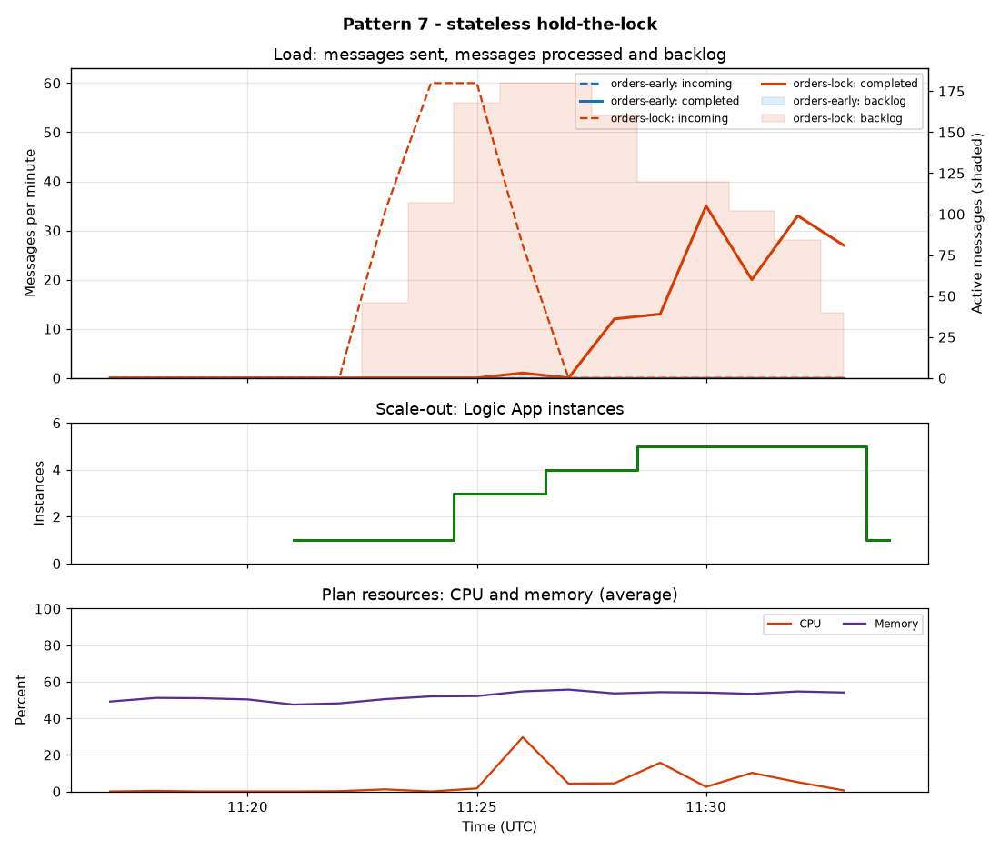
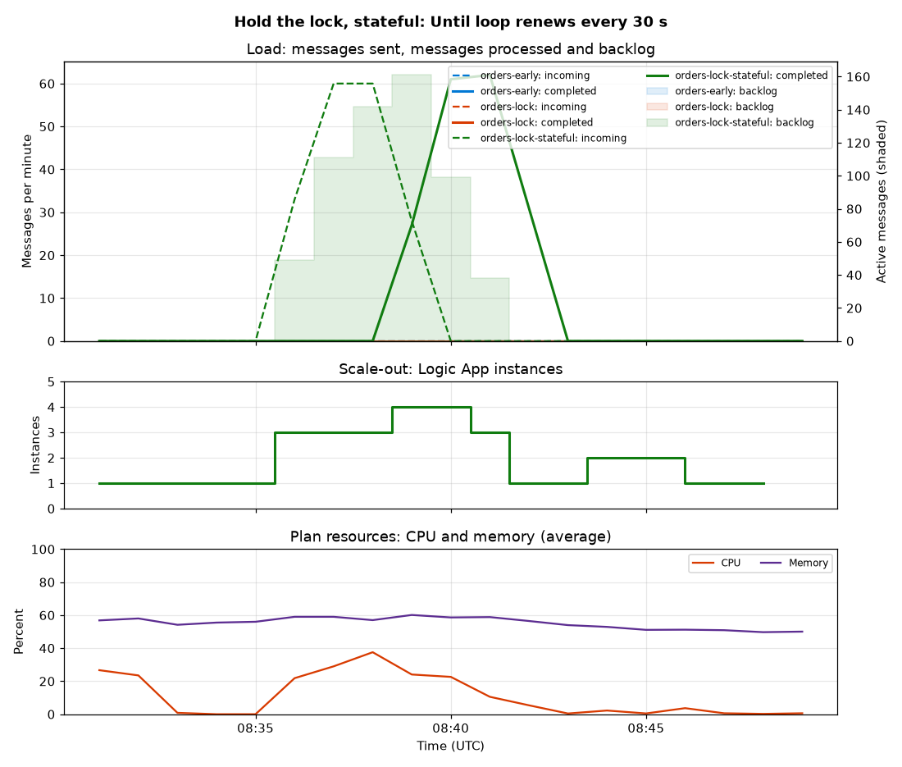

# Process long-running work and handle redelivery

Docs page: `load-pattern-07-long-running.md`.

## What it shows

Each message starts about three minutes of work. The sample compares three ways to keep the
message from being lost or delivered twice while that work runs:

1. **Settle early.** A Stateful workflow with a `splitOn` Service Bus trigger takes the message
   from `orders-early` and settles it at once. The run then owns the work and its recovery: it
   waits three minutes and calls `Process_order`. Use this design when run history or a work
   record gives you an adequate recovery path. Service Bus can't deliver the message again.
2. **Hold the lock.** A Stateless workflow takes a batch of up to 20 messages from `orders-lock`
   in peek-lock mode. For each message it makes four 40-second HTTP calls to a Stateful
   `slow-downstream` workflow and renews the lock after each call. It then completes the message,
   or abandons it on failure. The queue lock is one minute, so the run must renew it.
3. **Hold the lock, Stateful.** A Stateful workflow with a `splitOn` peek-lock trigger takes
   each message from `orders-lock-stateful` into its own run. Two branches run in parallel: one
   makes the same four 40-second calls, and an Until loop renews the lock every 30 seconds until
   the work finishes. If a renewal fails, the loop sets `lockHeld` to false and stops. The run
   then completes the message, or abandons it on failure, only if it still holds the lock. If the
   lock is lost, the run leaves the message unsettled, and Service Bus delivers it again, so the
   work must be safe to repeat. Use this design when you need Service Bus redelivery.
   Stateful settle and renew actions need VNet integration and `vnetPrivatePortsCount` of 2 or
   more; `Set-VnetPorts.ps1` sets both.

## Flow

```text
Settle early (long-running-settle-early, Stateful)
  orders-early --splitOn trigger (message settled)--> Wait 3 min --> Process_order

Hold the lock (long-running-peeklock-stateless, Stateless)
  orders-lock --peek-lock batch (<=20)--> For_each (concurrency 20)
     4 x [ HTTP POST slow-downstream (Wait 40 s) --> Renew_lock ]
     --> Process_order --> Complete_message  (Abandon_message on failure)

Hold the lock, Stateful (long-running-peeklock-stateful, Stateful, VNet ports >= 2)
  orders-lock-stateful --peek-lock splitOn trigger (one run per message)-->
     Set status = Running, lockHeld = true, then in parallel:
       Process_message: 4 x HTTP POST slow-downstream (Wait 40 s) --> Process_order
         --> Set status (after Process_message succeeds or fails)
       Keep_lock_alive: Until status <> Running or not lockHeld
         [ Wait 30 s --> Renew_lock --(fails)--> Mark_lock_lost (lockHeld = false) ]
     --> Settle_message: if lockHeld
           Complete_message  (Abandon_message on failure)
         else
           leave unsettled; Service Bus delivers the message again after the lock expires
```

## Settings (`params.json`)

| Setting | Value | Why |
|---|---|---|
| Plan | WS1, min 1, max 20 workers | Shared kit default. |
| Service Bus | Standard | Lock duration up to 5 minutes. |
| `orders-early` | lock PT5M, max delivery 10 | Lock only matters until the trigger settles it. |
| `orders-lock` | lock PT1M, max delivery 10 | Forces the run to renew the lock. |
| `orders-lock-stateful` | lock PT1M, max delivery 10 | Same as `orders-lock`, for the Stateful run. |
| VNet integration | `vnet-msgpat-7longrunning`, `vnetPrivatePortsCount` 2 | Stateful renew, complete and abandon fail without it. Set by `Set-VnetPorts.ps1`. |
| `host.json` | `maxMessageBatchSize` 20, `prefetchCount` 0, `maxAutoLockRenewalDuration` 00:05:00 | No prefetch, so messages do not sit locked in a buffer. |
| `loadTest` | `orders-early`, 2 msgs x 1/s for 5 min | Run 1. Runs 2 and 3 used 1 msg x 1/s for 3 min on `orders-lock` and `orders-lock-stateful`. |
| `drainMinutes` | 8 | Long runs need time to finish. |
| `measurement.workflowName` | `long-running-settle-early` | Workflow that `Export-Results.ps1` reads. |

`Invoke-LoadTest.ps1` has no queue switch. To repeat run 2, set `loadTest.queueName` to
`orders-lock`, `batchSize` 1, `durationMinutes` 3 and `measurement.workflowName` to
`long-running-peeklock-stateless`, then restore the values. For run 3 use `orders-lock-stateful`
and `long-running-peeklock-stateful`.

## Run

```powershell
$env:PATH = "C:\Program Files\Microsoft SDKs\Azure\CLI2\wbin;$env:PATH"
.\scripts\Deploy-Pattern.ps1     -Pattern 7-long-running
.\patterns\7-long-running\Set-VnetPorts.ps1                        # after every deploy
.\scripts\Invoke-LoadTest.ps1     -Pattern 7-long-running            # defaults from params.json
.\scripts\Export-Results.ps1     -Pattern 7-long-running -RunId <runId>
.\patterns\7-long-running\Measure-Run.ps1 -RunId <runId> -StartUtc <start> -EndUtc <end>
.\scripts\Set-PatternScale.ps1   -Pattern 7-long-running -Down
```

`Measure-Run.ps1` runs the queries in `queries\` (action status, in-flight runs, delivery count,
end-to-end latency by workflow, instances) and pulls memory and dead-letter metrics into
`results\7-long-running\<runId>\pattern7\`.

## Results

All runs: westus3, WS1, Service Bus Standard. Charts are in `results/7-long-running/<runId>/`.

| Metric | Run 1: settle early | Run 2: hold the lock, Stateless | Run 3: hold the lock, Stateful |
|---|---|---|---|
| Run id | `run-20261122-105441` | `run-20261122-111837` | `run-20261128-083205` |
| Load | 2 msg/s, 5 min (602 msgs) | 1 msg/s, 3 min (181 msgs) | 1 msg/s, 3 min (181 msgs) |
| Runs | 602 succeeded, 0 failed | 10 batch runs, 181 messages, all succeeded | 181 runs (one per message), all succeeded |
| Throughput | about 2 msg/s | 0.26 msg/s | 0.52 msg/s |
| Run duration p50 / p99 | 181.9 s / 182.0 s | 177.0 s / 186.6 s | 183 s / 189 s |
| End-to-end p50 / p95 / p99 | 182.5 s / 183.0 s / 183.1 s | 443.6 s / 527.8 s / 540.8 s | 164 s / 171 s / 175 s |
| Peak runs in flight | 364 | 5 runs (up to 100 locked messages) | 178 |
| Peak queue backlog | 0 | 180 | 161 |
| Redelivered (deliveryCount > 1) | 0 | 0 | 0 |
| Lock renewals | n/a | 724, all succeeded (p95 200 ms) | 1,086 (6 per message, every 30 s), all succeeded (p50 21 ms) |
| Dead letters | 0 | 0 | 0 |
| Max instances | 2 | 5 | 4 |
| Plan CPU, minute average (mean / peak) | n/a | 4.5% / 29.7% | 11.1% / 37.6% |
| Plan CPU, highest per-minute max | n/a | 99% | 97% |
| Plan memory (mean / peak) | n/a | 52% / 64% | 55% / 66% |
| Max worker memory | about 317 MB | about 327 MB | about 416 MB |
| Storage transactions | n/a | 38,892 (peak 6,797/min) | not measured |

- Settling early let the app accept 2 msg/s while 364 runs waited at once on two workers. The
  queue never backed up, and end-to-end latency was the three-minute wait plus about one second.
- Holding the lock also lost nothing: no lock was lost, no message came back, and 724 renewals
  succeeded. But each Stateless run held its batch for about three minutes, so throughput fell
  to about 0.26 msg/s. Messages waited up to seven minutes in the queue before a run took them.
- Holding the lock in a Stateful workflow reached 0.52 msg/s with end-to-end p50 of 164 s on up
  to four instances. The `splitOn` trigger gives each message its own run, so up to 178 runs held
  their locks at once. The Stateless runs worked through each batch one message at a time and
  scaled out to five instances. The designs renew differently and scaled to different instance
  counts, so these runs don't rank them.
- The Until loop renewed each lock six times, 1,086 renewals in all, with no failure, no
  redelivery and no dead letter. Each run took about 20 seconds longer than its work, because
  the run settles only after the loop finishes its current 30-second wait.
- The renewal loop does not depend on how long each step takes, so it also protects work whose
  steps run longer than the lock duration.
- The broker `CompletedMessages` metric showed 141 of 181 at export time in run 2.
  `Complete_message` succeeded 181 times and the queue was empty afterwards, so the metric lagged.

### Charts

| Run | Incoming vs processing, instances, CPU and memory | Other charts |
|---|---|---|
| Run 1: settle early | n/a | [throughput](../../results/7-long-running/run-20261122-105441/throughput.png), [instances](../../results/7-long-running/run-20261122-105441/instances.png), [end-to-end latency](../../results/7-long-running/run-20261122-105441/e2e-latency.png) |
| Run 2: hold the lock, Stateless | [timeline](../../results/7-long-running/run-20261122-111837/timeline.png) | [throughput](../../results/7-long-running/run-20261122-111837/throughput.png), [queue backlog](../../results/7-long-running/run-20261122-111837/queue-backlog.png), [end-to-end latency](../../results/7-long-running/run-20261122-111837/e2e-latency.png) |
| Run 3: hold the lock, Stateful | [timeline](../../results/7-long-running/run-20261128-083205/timeline.png) | [throughput](../../results/7-long-running/run-20261128-083205/throughput.png), [queue backlog](../../results/7-long-running/run-20261128-083205/queue-backlog.png), [end-to-end latency](../../results/7-long-running/run-20261128-083205/e2e-latency.png) |





## Notes

- **Stateful peek-lock needs VNet private ports.** A Stateful workflow that completes or renews
  a peek-lock message fails with `VNetPrivatePortsNotConfigured` unless the app has VNet
  integration with `vnetPrivatePortsCount` of 2 or more (`ServiceProviderActionJob.cs`).
  Without it the lock lapsed and the message came back about once a minute (delivery count 6).
  `Set-VnetPorts.ps1` creates the VNet, integrates the app and sets the ports. A Bicep deploy
  resets these settings and `SlowDownstreamUrl`, so rerun the script after every deploy.
- **Stateless runs stop at the run timeout, 5 minutes by default.** The timeout is
  configurable. Stateful runs can last much longer, so this sample uses a Stateful workflow for
  work that outlasts the stateless timeout.
- **Stateless workflows reject `Wait`** (`WorkflowRunActionTypeUnsupported`), and the
  built-in Workflow action from a Stateless parent to a Stateful child returns 202 at once.
  The sample calls the child's callback URL over HTTP so that the call blocks.
- **HTTP calls time out at 3 min 45 s** (`HttpOperation.RequestTimeout`). Raise it for slower
  calls, or use the async 202 polling or webhook pattern.
- A workflow cannot change from Stateful to Stateless in place (`InvalidFlowKind`). Use a new name.
- `maxAutoLockRenewalDuration` comes from the WebJobs Service Bus extension, not from Logic Apps
  code. It covers only the time the host holds the lock. The explicit `Renew_lock` action calls
  `RenewMessageLockAsync` in `ServiceBusServiceOperationsProvider.cs`.
