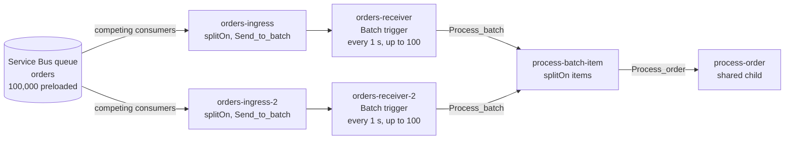
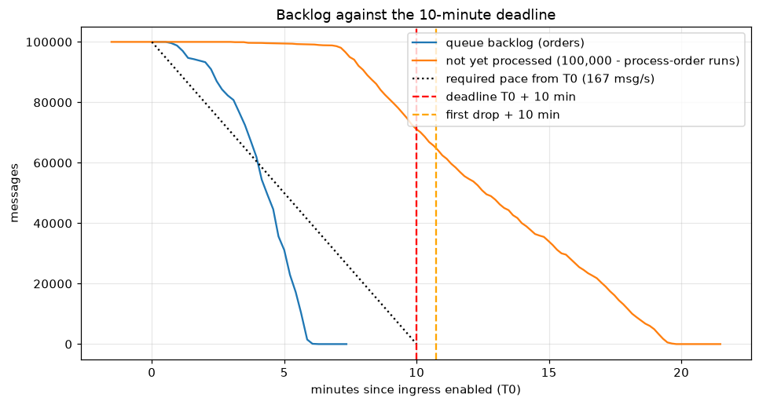
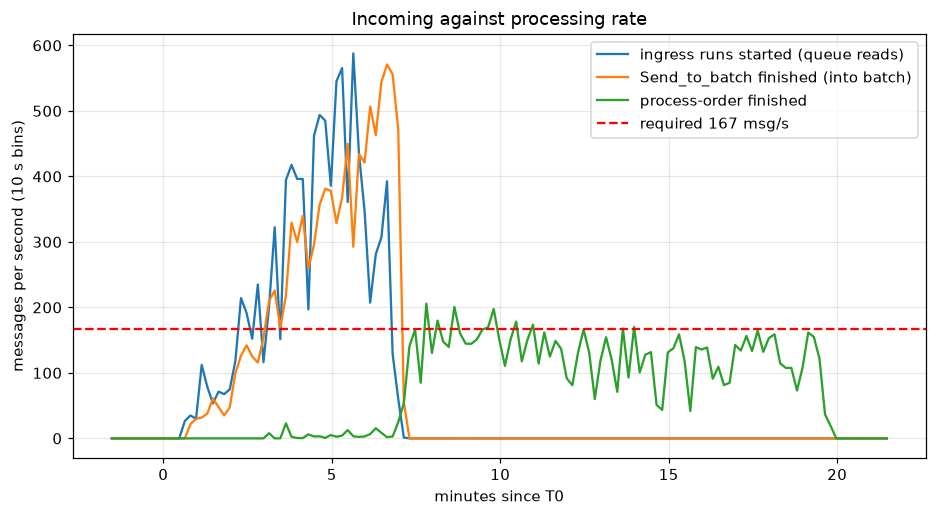
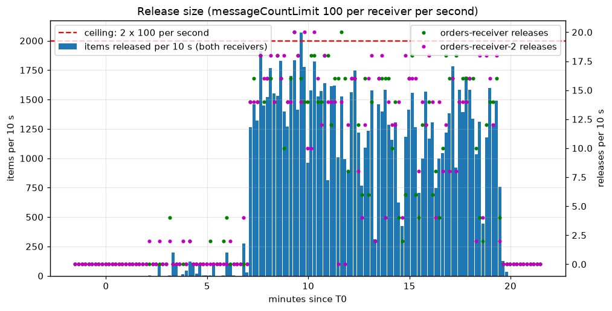
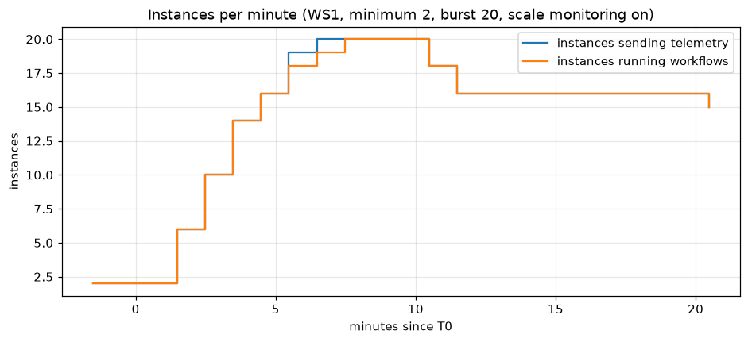
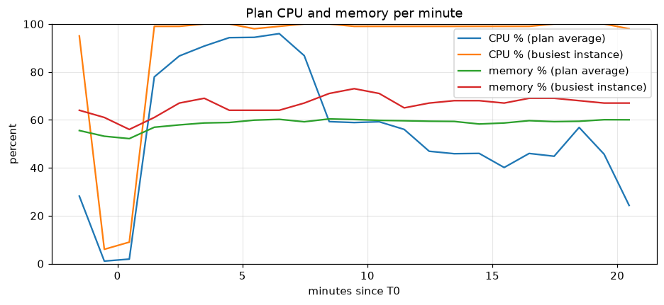

# Batch deadline: drain a known backlog before a deadline

## What it shows

A known backlog of 100,000 orders waits on the queue before the workflows start. It
must be processed within a deadline of 10 minutes. The sample uses the Logic Apps
batch trigger (`Batch` / `SendToBatch`) and sizes each batch release so the receivers
can reach the required rate, then shows whether the backlog reaches zero in time.

**Result:** the deadline was missed. The queue emptied 21.3 minutes after the
workflows started, and only 5,862 of the 100,000 orders were processed after 31 minutes.
The bottleneck was the batch path, not Service Bus or the plan size. See
[Results](#results) and [Why it missed](#why-it-missed).

## Flow



- `orders-ingress` and `orders-ingress-2` are identical stateful workflows. Both use the
  built-in Service Bus `receiveQueueMessages` trigger on `orders`, with
  `maxMessageBatchSize` 100 and `splitOn`. Service Bus spreads messages between them as
  competing consumers. Each one sends to its own receiver (`orders-receiver` and
  `orders-receiver-2`), batch `orders`, partition `default`.
- Each receiver releases on a 1-second recurrence with at most 100 messages
  (`recurrence.messageCountLimit`). It calls `process-batch-item` with the batch.
- `process-batch-item` splits `items` into one run per order and calls the shared
  `process-order` child (Liquid, C# custom code, Cosmos DB upsert). `Process_order`
  carries the tracked properties `messageId`, `enqueuedTimeUtc`, `sentAtUtc` and `pattern`.

## Sizing

```
required rate     = backlog / deadline          = 100,000 / 600 s  = 166.7 msg/s
per-receiver rate = messageCountLimit / interval = 100 / 1 s        = 100 msg/s
receivers needed  = ceil(required / per-receiver) = ceil(166.7 / 100) = 2
```

One receiver releasing 100 messages a second gives 100 msg/s, short of 167. Two
receivers give a ceiling of 200 msg/s. Each receiver needs about 84 msg/s.

**Ingress split.** A batch receiver accepts messages only from `SendToBatch`, so the split
happens at the queue. Two ingress workflows read the same queue as competing consumers,
and each feeds one receiver. Service Bus decides the split; in the latest run it was
50,448 / 50,555 trigger runs (50% / 50%). Splitting by partition name inside one receiver does not
help: the release job releases per partition, but the 1-second recurrence and the
per-trigger release limit still apply to one trigger.

## Release criteria

The batch trigger accepts these `releaseCriteria` property names:

| Property | Meaning |
|---|---|
| `messageCount` | Release when this many messages are waiting. |
| `batchSize` | Release when the waiting messages reach this size in bytes. |
| `recurrence` (`frequency`, `interval`) | Release on a schedule. |
| `recurrence.messageCountLimit` | Upper limit of messages per scheduled release (1–8000). |

`messageCountLimit` cannot be combined with a top-level `messageCount` or `batchSize`,
and the runtime accepts it only when `Runtime.BatchConfiguration.AllowMessageCountInRecurrence`
is `true`. One run of the release job does at most 15 releases.

## Settings

| Setting | Value | Why |
|---|---|---|
| Plan | WS1, minimum 2, maximum burst 20, runtime scale monitoring on | Scale out early from the queue length. The site minimum is 2; no prewarm. |
| Service Bus | Standard, queue `orders` lock 5 min, max delivery 10, 5 GB | |
| Ingress trigger | `maxMessageBatchSize` 100, `splitOn` | |
| host.json | `extensions.serviceBus.maxMessageBatchSize` 100, `prefetchCount` 0 | |
| `Runtime.BatchConfiguration.MinimumRecurrenceInterval` | `00:00:01` | Allows a 1-second recurrence (the default minimum is longer). |
| `Runtime.BatchConfiguration.AllowMessageCountInRecurrence` | `true` | Enables `recurrence.messageCountLimit`. |
| `Runtime.FlowBatchTriggerReleaseJob.ExecutionInterval` | `00:00:00.100` | Checks for due releases every 100 ms. |
| `Runtime.FlowBatchTriggerPushJob.ExecutionInterval` | `00:00:01` | Pushes released batches every second. |
| `Runtime.FlowBatchTriggerPushJob.DisableSafetyLimitsRelease` | `true` | Removes the safety limit on releases per push. |

The host settings live in `params.json` under `hostSettings`.

## Run

```powershell
$env:PATH = "C:\Program Files\Microsoft SDKs\Azure\CLI2\wbin;$env:PATH"
$py = "C:\Program Files\Microsoft SDKs\Azure\CLI2\python.exe"
.\scripts\Deploy-Pattern.ps1 -Pattern batch-deadline
.\patterns\batch-deadline\tools\Reset-Queue.ps1 -Pattern batch-deadline

# Stop the ingress workflows so the backlog builds up
# (app settings Workflows.orders-ingress.FlowState and Workflows.orders-ingress-2.FlowState = Disabled).

# Preload 100,000 messages. Start parallel senders a few seconds apart (see Kit issues).
& $py .\scripts\Send-TestMessages.py --pattern batch-deadline --queue orders --count 25000   # x4

# T0: remove the FlowState settings and record the time in the run folder's t0.txt.

# Export (window end after processing stops), then the pattern queries
& $py .\patterns\batch-deadline\tools\Export-Run.py <runFolder> <appInsightsAppId> <planResourceId> <windowEndUtc>
.\patterns\batch-deadline\tools\Run-Queries.ps1 -Pattern batch-deadline -StartUtc <start> -EndUtc <end> -RunId <runId>

# Scale down; keep the resource group
.\scripts\Set-PatternScale.ps1 -Pattern batch-deadline -Down
```

`tools\Export-Run.py` writes the CSVs, `summary.json` and the charts. `queries\` holds the
KQL: backlog against the deadline (`completion-time.kql`), releases and release size
(`releases-per-10s.kql`), the per-10-second timeline and instance-minutes.

## Results

Run `run-20261126-015032` (West US 3, wave 4). What changed from wave 3: runtime scale
monitoring on, site minimum 2 (no prewarm), maximum burst 20. The 100,000 messages were
sent from 01:50:41Z to 01:52:10Z with the ingress workflows disabled. T0 (ingress
enabled) was 01:52:31.6Z, deadline 02:02:31.6Z.

| Metric | Value |
|---|---|
| Backlog / deadline | 100,000 messages / 10 min (required 166.7 msg/s) |
| First queue drop | T0 + 44 s |
| Queue empty | T0 + 378 s = **6.3 min** |
| Queue drain rate (first drop to empty) | 299.4 msg/s |
| Ingress trigger runs / `Send_to_batch` completed | 101,003 / 100,000 (split 50,448 / 50,555) |
| `Send_to_batch` action duration p50 / p95 | 3.0 s / 7.8 s |
| Batch releases (`Process_batch`) | 2,002 (1,000 + 1,002), 101,001 items released, average 50 per release |
| Orders processed by the deadline | **27,240** of 100,000 |
| Orders processed (`Process_order`) | 100,000, 0 failed; last finished 02:12:28.9Z |
| All orders done | T0 + 19.95 min (deadline missed by about 10 min) |
| Messages left in the batch | 0 |
| Processing rate | average 99.2 orders/s; peak 205.7 runs/s in a 10-second bin |
| Latency from T0, p50 / p95 | 765 s / 1,148 s (12.7 / 19.1 min) |
| Latency from send, p50 / p95 / p99 | 828 s / 1,184 s / 1,216 s (13.8 / 19.7 / 20.3 min) |
| `Process_order` action duration p50 / p95 / p99 | 5.8 s / 14.4 s / 25.4 s |
| Instances | 2 until T0 + 1 min, then 6, 10, 14, 16, 19; 20 from T0 + 6.5 min to the deadline, then 16 |
| Instance-minutes | 326 |
| CPU peak | 100% per instance; 96.0% plan average |
| Memory peak | 73% |

### Wave 3 compared with wave 4

| Metric | Wave 3 (`run-20261125-230638`) | Wave 4 (`run-20261126-015032`) |
|---|---|---|
| Scale settings | minimum 10 (prewarm), burst 10, scale monitoring off | minimum 2, burst 20, scale monitoring on |
| First queue drop | T0 + 315 s | T0 + 44 s |
| Queue empty | 21.3 min | 6.3 min |
| Releases / average size | 134 / 44 | 2,002 / 50 |
| Orders processed | 5,862 (about 94,000 left in the batch) | 100,000 (0 left) |
| Average / peak orders/s | 5.95 / 61.2 | 99.2 / 205.7 |
| Latency from send p50 / p95 | 2,078 s / 2,136 s | 828 s / 1,184 s |
| Instances | peak 8; 1 working for the first 7 minutes | 2 to 20 in 6.5 minutes; all 20 busy |
| CPU peak / plan average | 99% / 38.9% | 100% / 96.0% |
| Memory peak | 68% | 73% |

### Charts

All charts are in [`results/batch-deadline/run-20261126-015032`](../../results/batch-deadline/run-20261126-015032).

| Chart | Shows |
|---|---|
|  | Queue backlog and unprocessed orders against the required pace and the deadline. |
|  | Ingress runs, `Send_to_batch` completions and `process-order` completions per second. |
|  | Releases and items released per 10 seconds. |
|  | Instances per minute. |
|  | Plan CPU and memory. |

## Why it missed

Scale-out now works: the triggers started in 44 seconds, the plan grew from 2 to 20
instances in 6.5 minutes and every instance did work. The queue emptied in 6.3 minutes.
The deadline still failed because the batch path, not the queue, limits throughput.

1. **Releases cap throughput at about 100 msg/s.** The two receivers kept the 1-second
   schedule (2,002 releases in 17 minutes), but each release held 50 items on average,
   not the 100 allowed. Two receivers × 1 release/s × 50 items gives about 100 msg/s,
   short of 167. The backlog moved from the queue into the batch store and waited there.
2. **The plan ran out of CPU.** All 20 instances ran at 96–100% CPU. The stateful
   `Send_to_batch`, `splitOn` fan-out and the stateful child call cost four workflow
   runs per order.
3. **Child calls slowed under load.** `Process_order` took 5.8 s at p50 and 14.4 s at
   p95, against about 1 s per action inside `process-order`.

## Tuning advice

- Turn on runtime scale monitoring and allow a burst of 20 or more. With it, the
  triggers start in under a minute and the plan scales out from the queue length.
- Raise `messageCountLimit` (up to 8000) and use fewer, larger releases. The release
  count is the limit, not the message count per release.
- Add more ingress/receiver pairs, and set `prefetchCount` above 0.
- Use a stateless ingress workflow if the run history is not needed.
- In `process-batch-item`, loop over the items with a For each (with concurrency)
  instead of `splitOn`, or process the batch in one child call.
- For a hard deadline at this scale, consider a non-batch design: read the queue directly
  with concurrency, as in [2a-drain-fast](../2a-drain-fast/README.md). The batch trigger
  adds two stateful hops per message.

## Kit issues

- Parallel `Send-TestMessages.py` runs fail with an `az` invoke error when they start at
  the same moment. Start them a few seconds apart.
- With runtime scale monitoring off, the Service Bus trigger took about 5 minutes to
  start after the FlowState app settings were removed. With it on, it took 44 seconds.
- The shared `releases-per-10s.kql` template referenced `prop__releaseSize`, which the
  batch trigger does not emit. The pattern query counts `Process_batch` runs instead.
- The `/runs` management API times out under this load; use App Insights.
- A site minimum of 10 instances does not spread the trigger work. Runtime scale
  monitoring with a burst of 20 does.
- The shared queries assume `Process_order` runs in the measured workflow.
- The `az` CLI Python ignores `PYTHONPATH`, so `Export-Run.py` adds the kit's pylib to
  `sys.path` from `__file__`.
- `last` is reserved in KQL; the queries use `lastAt`.
- `az --query` filters with `[?...]` break under `cmd`.
- A KQL `range` must start on a bin boundary. Otherwise the left-outer joins with
  `bin(timestamp, 10s)` return no matches and every count is 0. `Export-Run.py` floors
  the window start to the minute.
