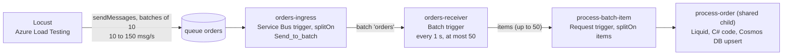
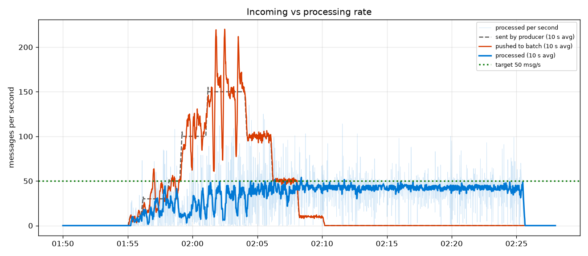
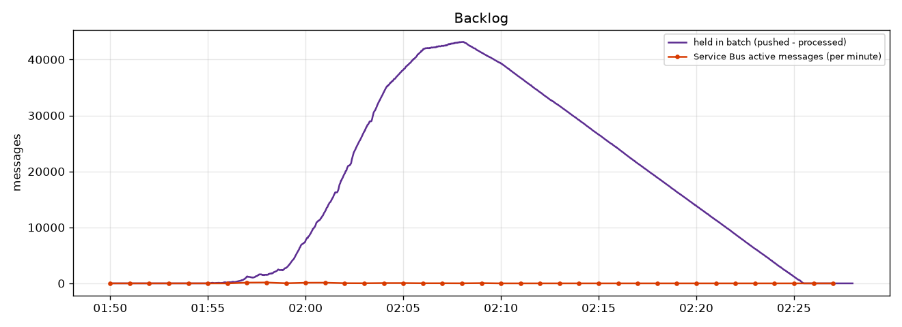
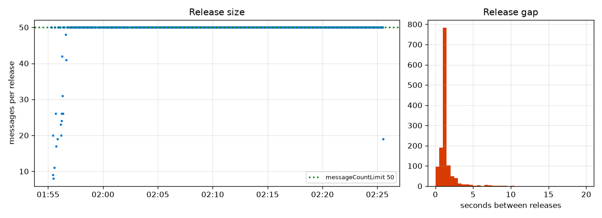
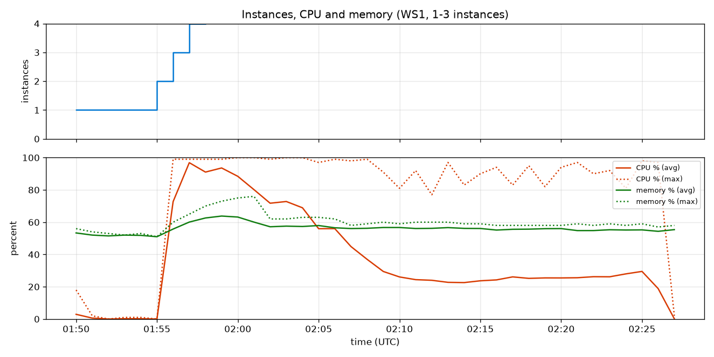
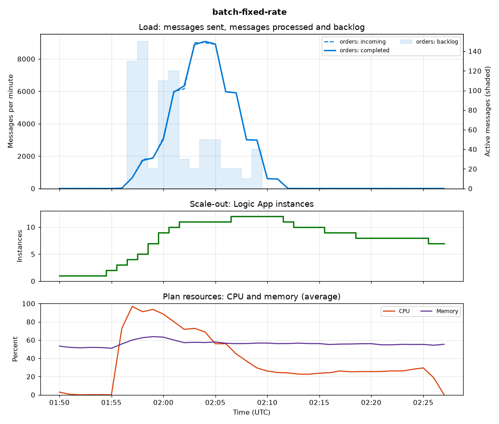

# Batch fixed rate: 50 messages per second

## What it shows

How to hold processing to a contracted rate, for example an API that allows 50 calls per
second. A batch trigger releases at most 50 messages every second:

```
messages per release = rate x interval = 50 msg/s x 1 s = 50
```

The goal: when incoming traffic is above 50 msg/s, processing stays at 50 and the excess waits
in the batch. When incoming traffic is below 50, processing follows it. When the load stops,
the backlog drains at 50 msg/s.

**Result on WS1 with scale-out: the cap holds and processing reaches about 42 msg/s.** The plan
scaled from 1 to 12 instances. No release was larger than 50, and the batch drained fully about
13 minutes after the load stopped. Processing held at about 41 to 44 msg/s (per-minute average)
while the batch had a backlog, not 50, because releases came about every 1.16 s instead of every
1 s. See [Results](#results).

## Flow



- `orders-ingress` takes each queue message (auto-complete) and calls `Send_to_batch` with batch
  name `orders`.
- `orders-receiver` has the batch trigger. Each release calls `process-batch-item` once with the
  released items.
- `process-batch-item` splits on `items`, so each message gets its own run. `Process_order` calls
  the shared child workflow `process-order` and sets the tracked properties used by the
  latency queries.

## Release criteria

```json
"releaseCriteria": {
  "recurrence": { "frequency": "Second", "interval": 1, "messageCountLimit": 50 }
}
```

| Property | Accepted | Effect |
|---|---|---|
| `recurrence.messageCountLimit` | Yes, 1 to 8000, needs `AllowMessageCountInRecurrence` | Caps each scheduled release. This is the rate limit. |
| `recurrence.frequency` `Second`, `interval` 1 | Yes, when `MinimumRecurrenceInterval` is 1 s or less | One release each second |
| top-level `messageCount` | Yes | Releases when the count is reached. A threshold, not a cap. |
| top-level `batchSize` | Yes | Releases when the size in bytes is reached. A threshold, not a cap. |
| `recurrence.count` | No, rejected at save | |

Only `recurrence.messageCountLimit` gives a fixed rate. `messageCount` and `batchSize` release
sooner when traffic is high, which raises the rate instead of limiting it.

## Settings (`params.json`)

| Setting | Value |
|---|---|
| Plan | WS1, `minimumElasticInstanceCount` 1, `maximumElasticWorkerCount` 20, runtime scale monitoring on |
| Queue `orders` | lock 5 min, max delivery 10, 5 GB, no sessions |
| host.json | `extensions.serviceBus.maxMessageBatchSize` 100, `prefetchCount` 0 |
| Load | 15 users x 10 messages x 1 batch/s, stepped with `STEPS` (below), 15 min |

Host settings (`hostSettings` in `params.json`, applied as app settings
`Runtime.*`; a change needs a code redeploy to take effect):

| Host setting | Value | Why |
|---|---|---|
| `Runtime.BatchConfiguration.MinimumRecurrenceInterval` | `00:00:01` | Allows a 1 s recurrence (default minimum is longer) |
| `Runtime.BatchConfiguration.AllowMessageCountInRecurrence` | `true` | Enables `recurrence.messageCountLimit` |
| `Runtime.FlowBatchTriggerReleaseJob.ExecutionInterval` | `00:00:00.100` | The release job checks every 100 ms |
| `Runtime.FlowBatchTriggerPushJob.ExecutionInterval` | `00:00:01` | Pushed messages reach the batch within 1 s |
| `Runtime.FlowBatchTriggerPushJob.DisableSafetyLimitsRelease` | `true` | Stops the safety limit from releasing early, which would break the cap |

Load profile (`STEPS` = users:seconds, each user sends 10 msg/s):

| Users | 1 | 3 | 5 | 10 | 15 | 10 | 5 | 1 |
|---|---|---|---|---|---|---|---|---|
| msg/s | 10 | 30 | 50 | 100 | 150 | 100 | 50 | 10 |
| Seconds | 60 | 120 | 60 | 120 | 180 | 120 | 120 | 120 |

That sends about 65,400 messages. Above 50 msg/s the batch should build a backlog; below 50 it
should drain.

## Run

```powershell
$env:PATH = "C:\Program Files\Microsoft SDKs\Azure\CLI2\wbin;$env:PATH"
.\scripts\Deploy-Pattern.ps1   -Pattern batch-fixed-rate
.\scripts\Invoke-LoadTest.ps1  -Pattern batch-fixed-rate
.\scripts\Export-Results.ps1   -Pattern batch-fixed-rate
.\scripts\Export-PlanMetrics.ps1 -Pattern batch-fixed-rate
.\patterns\batch-fixed-rate\tools\Run-Queries.ps1 -Pattern batch-fixed-rate -RunId <runId> -StartUtc <start> -EndUtc <end>
python .\patterns\batch-fixed-rate\tools\New-FixedRateCharts.py results\batch-fixed-rate\<runId> 50
.\scripts\Set-PatternScale.ps1 -Pattern batch-fixed-rate -Down
```

Use the same UTC window for all export steps. `Export-Results.ps1` waits only for the queue to
empty; the batch store can still hold messages, so set the window end yourself.
`tools\Reset-Queue.ps1` empties the queue between runs. The KQL files are in `queries\`.

## Results

Run `run-20261126-015155`, westus3, WS1, window 01:50 to 02:28 UTC. Files:
`results/batch-fixed-rate/run-20261126-015155/`. This run allowed 20 elastic workers and turned on
runtime scale monitoring; the earlier run on this page allowed 3 and stayed on 1 instance.

| Metric | Value |
|---|---|
| Messages sent and completed by Service Bus | 65,610 |
| Messages processed | 65,610 (0 failed, 0 dead-lettered, 0 exceptions) |
| Target rate | 50 msg/s |
| Average processing rate | 36.1 msg/s over 1,816 s |
| Rate while the batch had a backlog (02:05 to 02:24, per-minute average) | 41 to 44 msg/s |
| Highest 10 s average | 54 msg/s |
| Highest second | 135 (385 seconds above 50) |
| Releases | 1,321; p50, p95 and max size 50; 1,304 at exactly 50; none above 50 |
| Gap between releases | p50 1.16 s, p95 2.9 s, max 10.3 s |
| End-to-end latency (sent to processed) | p50 10.0 min, p95 16.8 min, p99 16.9 min |
| Child run duration | p50 2.7 s, p95 10.6 s |
| Peak queue backlog | 150 |
| Peak batch backlog (pushed, not processed) | 43,170 |
| Left in the batch at the end | 0; last message processed at 02:25:32, 30.5 min after the first |
| Instances | 1 at start, 12 at peak (02:07), 7 to 8 during the drain |
| CPU (01:55 to 02:25) | avg 44%; 89% to 97% per-minute while scaling out (01:57 to 02:00), about 25% during the drain; peak 100% |
| Memory | avg 57%, max 76% |

Compared with the run on 1 instance (`run-20261125-230734`):

| Metric | 1 instance | Up to 12 instances |
|---|---|---|
| Average processing rate | 2 msg/s | 36.1 msg/s |
| Steady rate with a backlog | about 12 msg/s | 41 to 44 msg/s |
| Releases (max size) | 143 (50) | 1,321 (50) |
| Release gap p50 / max | 3.9 s / 945 s | 1.16 s / 10.3 s |
| End-to-end latency p50 / p95 | 47.1 / 50.5 min | 10.0 / 16.8 min |
| Peak queue backlog | 25,650 | 150 |
| Left in the batch at the end | about 59,000 | 0 |
| CPU avg | 89% | 44% |

What happened:

1. **The plan scaled out.** Instances went from 1 to 11 by 02:02 and to 12 at 02:07, then fell
   to 7 as the load ended. CPU was about 90% for the first five minutes and then dropped to
   about 25%.
2. **Ingress kept up.** The queue never held more than 150 messages, and the rate pushed to the
   batch (orange in `rate.png`) followed the producer, up to 150 msg/s. The batch built a backlog
   of 43,170 messages, as intended when incoming traffic is above 50.
3. **Each release is capped, the rate is not exact.** No release was above 50. But processing
   settled at about 42 msg/s, not 50: releases came every 1.16 s at p50, so the release job, not
   the CPU, set the rate. In 284 cases two releases came less than 1 s apart, and the child runs
   of several releases finished in the same second. That is why single seconds reached 135. Over
   10 s, the highest average was 54 msg/s and the most released was 550 messages.
4. **The drain finished.** The producer stopped at 02:12; the last message was processed at
   02:25. Nothing was left in the batch.

The cap holds with scale-out, and processing comes within about 15% of the target. A downstream
API with a strict per-second limit can still see short bursts above 50.

### Charts

Incoming vs processing rate, with the 50 msg/s target. The light blue trace is per second; the
orange line is the rate pushed to the batch, which is the incoming rate at the batch.



Backlog: messages held in the batch, and Service Bus active messages.



Release size and gap between releases.



Instances, CPU and memory.



Load, instances and resources over time.



The kit charts (`throughput.png`, `queue-backlog.png`, `e2e-latency.png`, `run-latency.png`,
`instances.png`, `failures.png`) are in the same folder. They cover only `process-batch-item` and
the queue, not the batch store. The run on 1 instance is in
`results/batch-fixed-rate/run-20261125-230734/`.

## What to change

To get closer to a steady 50 msg/s:

- Allow elastic scale-out: set `maximumElasticWorkerCount` well above 3 and turn on runtime scale
  monitoring. On 1 instance, ingress used the CPU and processing fell to 2 msg/s.
- To make up for a release interval longer than 1 s, raise `messageCountLimit` a little (for
  example 58 for about 50 msg/s at a 1.16 s gap). This also raises the largest burst, so don't
  do it if the API limit is strict per second.
- If the downstream limit is strict, enforce it at the caller as well, for example with an API
  Management rate limit. The batch caps each release, not each second across instances.
- Put the ingress (`orders-ingress`) in a separate Logic App so it cannot starve the release job.
  Note that `Send_to_batch` must target a batch workflow in the same app or by resource ID.
- Process the 50 items in one run instead of 50 child runs: loop in `orders-receiver`, or call
  the API once with all 50 items if it accepts a batch. That removes most of the per-message runs.
- Check `secondsAbove50` and the release gaps after each run. A good run has release gaps close
  to 1 s and a flat line near 50 msg/s while the batch has a backlog.

## Notes

- `messageCountLimit` caps each release, not the rate across instances. With several instances,
  two releases can land within the same second.

- `recurrence.messageCountLimit` is not in the public designer. Set it in code view and enable
  `AllowMessageCountInRecurrence`, or the save fails.
- The batch store is not a queue. The kit's drain check and its backlog chart look at Service
  Bus only; use `custom/timeline-per-second.json` (`backlog` column) for the batch backlog.
- `summary.json` shows `targetMessagesPerSecond` 150 (the peak step). The contracted target is 50.
