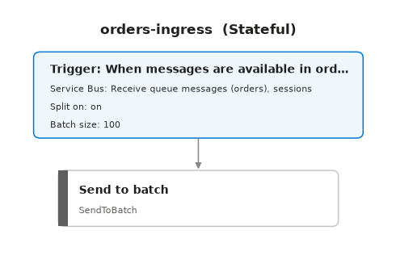
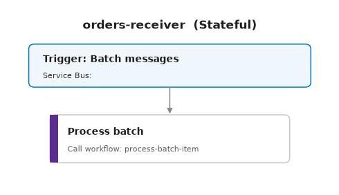
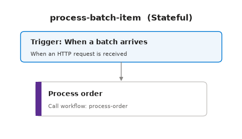
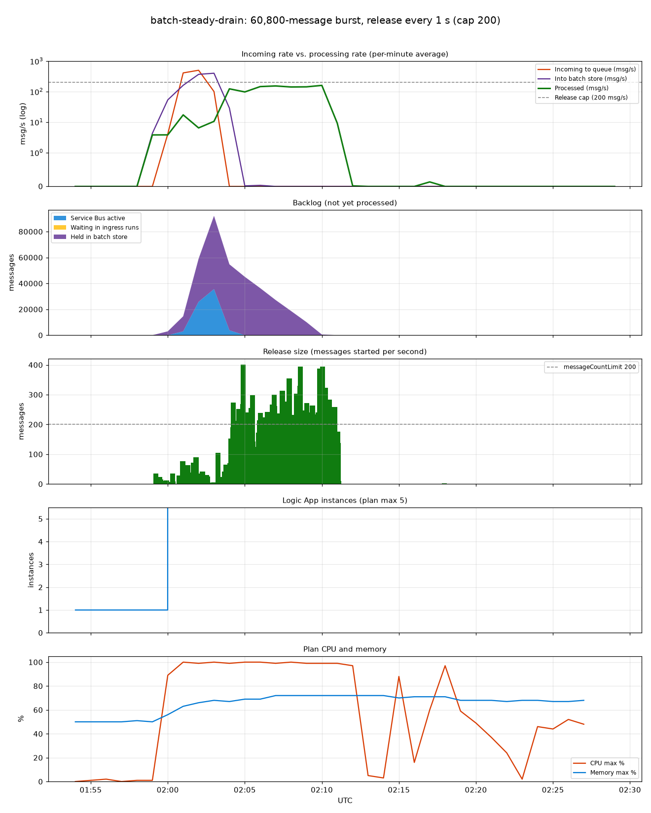
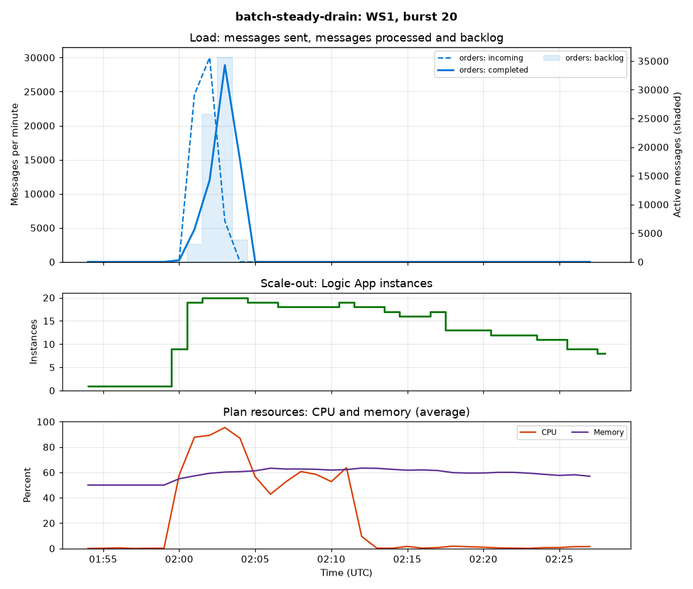

# Batch steady drain: release a backlog at a capped rate

## What it shows

A burst of messages lands in a Service Bus queue. The downstream service can only take a
fixed rate. A Logic Apps batch trigger holds the messages and releases at most 200 every
second, so the downstream sees a flat rate instead of a spike.

The test sends a short baseline, then a burst of about 60,000 messages, then nothing, and
watches the drain.

**Short answer from the run:** the processing rate stayed far below the burst rate, so the
batch did cut off the spike. But it was not flat near 200 msg/s. On one WS1 instance it
averaged about 0.7 msg/s, in bursts, and most of the backlog was still waiting when the run
ended. See [Results](#results) and [Why the drain was slow](#why-the-drain-was-slow).

## Flow

```
Locust (Azure Load Testing) --sendMessages--> queue "orders"
  -> orders-ingress (stateful)
       trigger: Service Bus receiveQueueMessages (built-in), splitOn, maxMessageBatchSize 100
       Send_to_batch: SendToBatch -> orders-receiver / Batch_messages, batch "orders"
  -> orders-receiver (stateful)
       trigger: Batch (Inline), releaseCriteria.recurrence every 1 s, messageCountLimit 200
       Process_batch: calls process-batch-item with the released items (waits for it)
  -> process-batch-item (stateful)
       trigger: Request, splitOn items -> one run per message
       Process_order: calls shared child "process-order"
            Liquid transform -> C# custom code -> Cosmos DB upsert -> Response
```

Diagrams from the deployed definitions:

| orders-ingress | orders-receiver | process-batch-item |
|---|---|---|
|  |  |  |

## How it works

1. `orders-ingress` takes messages off the queue, one run per message, and sends each one to
   the batch with `SendToBatch`. The trigger completes the Service Bus message when the run
   starts, so the backlog moves out of Service Bus into the app.
2. The batch store keeps the messages. Every second the release job checks the batch and
   releases up to 200 messages as one `orders-receiver` run.
3. `orders-receiver` passes the released items to `process-batch-item`, which splits them
   into one run per message. Each run calls `process-order`.
4. `Process_order` sets the tracked properties `messageId`, `enqueuedTimeUtc`, `sentAtUtc`
   and `pattern`, which the latency queries use.

### Release criteria the runtime accepted

```json
"releaseCriteria": {
  "recurrence": { "frequency": "Second", "interval": 1, "messageCountLimit": 200 }
}
```

- `recurrence.messageCountLimit` caps each release. It needs the host setting
  `Runtime.BatchConfiguration.AllowMessageCountInRecurrence`.
- `messageCountLimit` cannot be used with `releaseCriteria.messageCount` or
  `releaseCriteria.batchSize`.
- A 1-second recurrence needs `Runtime.BatchConfiguration.MinimumRecurrenceInterval`.

## Settings

### Host settings (`params.json` -> `hostSettings`, written to `host.json` at deploy)

| Setting | Value | Why |
|---|---|---|
| `Runtime.BatchConfiguration.MinimumRecurrenceInterval` | `00:00:01` | Allow a 1 s release recurrence |
| `Runtime.BatchConfiguration.AllowMessageCountInRecurrence` | `true` | Allow `messageCountLimit` in the recurrence |
| `Runtime.FlowBatchTriggerReleaseJob.ExecutionInterval` | `00:00:00.100` | Check for due releases every 100 ms |
| `Runtime.FlowBatchTriggerPushJob.ExecutionInterval` | `00:00:01` | Push released batches every second |
| `Runtime.FlowBatchTriggerPushJob.DisableSafetyLimitsRelease` | `true` | Do not release early on the safety limits |

### Other settings

| Setting | Value |
|---|---|
| Plan | WS1, `minimumElasticInstanceCount` 1, `maximumElasticWorkerCount` 20, runtime scale monitoring on |
| Queue `orders` | lock 5 min, max delivery 10, 5 GB, no sessions |
| host.json | `extensions.serviceBus.maxMessageBatchSize = 100`, `prefetchCount = 0` |
| Load | baseline 1 user x 5 msg/s for 60 s, burst 5 users x 100 msg/s for 120 s, quiet 60 s, then 15 min drain |

## Results

Run `run-20261126-015557`, westus3, WS1. All files are in
`results/batch-steady-drain/run-20261126-015557/`.

What changed since the first run (`run-20261125-230231`): runtime scale monitoring is on and
the plan can burst to 20 instances (was 5). The workflows and load are the same.

| Metric | First run (max 5, no scale monitoring) | This run (max 20, scale monitoring on) |
|---|---|---|
| Messages sent | 60,800 | 60,800 |
| Messages processed (`Process_order`) | 1,176 | 60,800 (all) |
| Left in the batch store at the end | about 59,600 | 0 |
| Peak Service Bus backlog | 54,900 | 35,600 |
| Processing rate, mean | 0.7 msg/s | 50.5 msg/s (54 msg/s over the active span) |
| Processing rate, peak minute | 3.45 msg/s | 159 msg/s (9,559 in the 02:10 minute) |
| Release size (messages per release second) | p50 9, p95 25, max 44 | p50 95, p95 262, max 401; 92 seconds above 200 |
| End-to-end latency | p50 630 s, p95 1,701 s | p50 398 s, p95 556 s, p99 590 s |
| `process-batch-item` run duration | p50 271 s, p95 692 s | p50 9.4 s, p95 18.4 s |
| Drain (first send to last processed) | 1,763 s, not finished | 1,203 s, finished at 02:19 |
| Instances | 1 the whole time | 1 to 9 at 02:00, 19-20 from 02:01 to 02:04; average 17 while busy |
| CPU (plan, per minute) | 96-100% max | average 41%, 87-95% average at the peak, max 100% |
| Memory (max per minute) | 67% | 72% |
| Failed actions | 0 | 112 `Process_order` timeouts (about 600 s), retried; 0 failed runs |

### Charts



The custom chart (`tools/New-DrainChart.py`) shows, top to bottom:

1. Incoming rate spikes during the burst. Processing stays low until about 02:04, then runs at
   300-400 msg/s per second (8,500-9,500 per minute) until the store is empty at 02:11.
2. Backlog: the Service Bus queue peaks at 35,600 and empties as more instances take ingress.
3. Release size: most release seconds are far above the first run. 92 seconds went over 200.
4. Instances: from 1 to 20 within 3 minutes of the burst, then a slow scale-in.
5. CPU: high while the burst is ingested and drained, then near 0.



Kit charts: [throughput](../../results/batch-steady-drain/run-20261126-015557/throughput.png),
[queue backlog](../../results/batch-steady-drain/run-20261126-015557/queue-backlog.png),
[e2e latency](../../results/batch-steady-drain/run-20261126-015557/e2e-latency.png),
[run latency](../../results/batch-steady-drain/run-20261126-015557/run-latency.png),
[instances](../../results/batch-steady-drain/run-20261126-015557/instances.png),
[failures](../../results/batch-steady-drain/run-20261126-015557/failures.png).

The custom query outputs and the KQL are in `custom/`. The kit's "runs" in `summary.json`
count `process-batch-item` runs, one per processed message. The first run's files are in
`results/batch-steady-drain/run-20261125-230231/`.

### What scale-out changed

- **The backlog drained.** With up to 20 workers, all 60,800 messages were processed in about
  20 minutes. The first run processed 1,176 on one worker.
- **Ingress still comes first.** Until 02:04 most of the CPU went to ingress runs and
  `SendToBatch`. Processing only took off once ingress was done, so most latency is wait time
  (p50 390 s of 398 s).
- **The 200 msg/s cap did not hold as a rate.** The release criterion is per batch, and with
  many workers several releases land in the same second. Up to 401 items started in one second.
  The flow was not flat: per-second CV 1.26.
- **Some child calls timed out.** 112 `Process_order` calls hit the 10-minute timeout while
  the workers were busy, then succeeded on retry.

### How to get closer to a flat 200 msg/s

- Do not wait on the child: remove `DisableAsyncPattern`, or call the child without waiting,
  so each release finishes in well under a second.
- Do less work per message: put the per-item steps in the receiver run (for each, with
  concurrency) instead of one child run per message plus another child call.
- Slow the ingress: put a trigger concurrency limit on `orders-ingress` so it does not take
  all the CPU, and leave the backlog in Service Bus where it is visible.
- Limit the release rate across workers: scale-out multiplies releases, so a flat rate needs
  a limit on the receiver (for example, trigger concurrency 1) as well as the batch size.

## Run

```powershell
$env:PATH = "C:\Program Files\Microsoft SDKs\Azure\CLI2\wbin;$env:PATH"
.\scripts\Deploy-Pattern.ps1     -Pattern batch-steady-drain
.\scripts\Invoke-LoadTest.ps1    -Pattern batch-steady-drain       # baseline, burst, quiet
.\scripts\Export-Results.ps1     -Pattern batch-steady-drain
.\patterns\batch-steady-drain\tools\Run-Queries.ps1 -Pattern batch-steady-drain   # custom KQL
python .\patterns\batch-steady-drain\tools\New-DrainChart.py `
    results\batch-steady-drain\<runId> results\batch-steady-drain\<runId>\batch-steady-drain.png
.\patterns\batch-steady-drain\tools\Reset-Queue.ps1 -Pattern batch-steady-drain
.\scripts\Set-PatternScale.ps1   -Pattern batch-steady-drain -Down
```

For `python`, use a real interpreter, not the Windows Store stub. The Azure CLI one works:
`C:\Program Files\Microsoft SDKs\Azure\CLI2\python.exe`, with `PYTHONPATH` set to `.tools\pylib`.

## Notes

- An empty Service Bus queue does not mean the drain is done. Check the processed count in
  App Insights (`queries/drain-flatness.kql`, `queries/timeline-per-minute.kql`).
- The batch store still held messages when the export ended. `Reset-Queue.ps1` clears the
  queue only; messages already in the batch keep releasing until the app is scaled down or
  the workflows are disabled.
- App Insights rejects some KQL names as aliases (`first`, `last`, `st`). The queries here
  avoid them.
