# Batch sustained rate: two release configurations, one incoming rate

## What it shows

Service Bus receives a steady 1,000 msg/s for 30 minutes (15 minutes warm-up, then a
15-minute steady window). Two Logic Apps Standard apps process the same stream through the
batch trigger. They differ only in the release configuration:

- **A**: 2 ingress+receiver pairs, `messageCountLimit` 200.
- **B**: 8 ingress+receiver pairs, `messageCountLimit` 500.

The release configuration caps the processing rate:

```
max processing rate = pairs x messageCountLimit / release interval
A: 2 x 200 / ~1.58 s = ~254 msg/s
B: 8 x 500 / ~1.1 s = ~3,800 msg/s (above 1,000 msg/s)
```

**Short answer from the run:** A was capped at 254 msg/s and its backlog grew to about
1.36 million. B kept up at 1,002 msg/s with a p95 latency of 17.9 s on up to 55 instances.
See [Results: 1,000 msg/s](#results-1000-msgs).

A high-scale round at 2,000 msg/s (4 pairs x 400 against 10 pairs x 500) scaled B to 89
instances. There, ingress used 87-96% of the plan CPU, so neither configuration reached its
release ceiling while messages arrived. The release configuration sets an upper bound;
the plan must also have the CPU to ingest the incoming rate. See
[High-scale round: 2,000 msg/s](#high-scale-round-2000-msgs).

## Flow

```
Send-Rate.py (1,000 or 2,000 msg/s) --> queue "orders"
  -> orders-ingress, orders-ingress-2, ... (one per pair, stateful)
       trigger: Service Bus receiveQueueMessages (built-in), splitOn, maxMessageBatchSize 100
       Send_to_batch: SendToBatch -> matching orders-receiver-N / Batch_messages, batch "orders"
  -> orders-receiver, orders-receiver-2, ... (one per pair, stateful)
       trigger: Batch (Inline), recurrence every 1 s, messageCountLimit 400 (A) or 500 (B)
       Tag_items: adds releaseId and receiver to each item
       Process_batch: calls process-batch-item (DisableAsyncPattern, waits)
  -> process-batch-item (stateful)
       trigger: Request, splitOn items -> one run per message
       Process_order: calls shared child "process-order" (tracked properties for latency)
```

`Build-BatchApp.ps1` builds the pairs for each configuration.
## How it works

1. Each ingress workflow reads the shared queue and sends each message to its own receiver's
   batch. All pairs compete for the same queue, so the load splits across them.
2. Each batch trigger has one release schedule. It releases at most `messageCountLimit`
   messages about every 1.1 s, even with a 1 s recurrence and a 100 ms release job.
3. More pairs give more release schedules, so the ceiling grows with the pair count.
4. The ingress run completes the Service Bus message when it starts. A backlog above the
   release ceiling therefore sits in the batch store, not in Service Bus.

## Settings

### Host settings (`host.json` -> `extensions.workflow.Settings`)

| Setting | Value | Why |
|---|---|---|
| `Runtime.BatchConfiguration.MinimumRecurrenceInterval` | `00:00:01` | Allow a 1 s release recurrence |
| `Runtime.BatchConfiguration.AllowMessageCountInRecurrence` | `true` | Allow `messageCountLimit` in the recurrence |
| `Runtime.FlowBatchTriggerReleaseJob.ExecutionInterval` | `00:00:00.100` | Check for due releases every 100 ms |
| `Runtime.FlowBatchTriggerPushJob.ExecutionInterval` | `00:00:01` | Push released batches every second |
| `Runtime.FlowBatchTriggerPushJob.DisableSafetyLimitsRelease` | `true` | Do not release early on the safety limits |
| `Runtime.ScaleUnitsCount` | `6` | Spread run storage over 6 storage accounts |
| `Jobs.NumPartitionsInJobTriggersQueue` | `8` | More job trigger partitions |
| `Runtime.Trigger.MaximumRunConcurrency` | `10000` | Do not cap runs per trigger |
| `Runtime.FlowTriggerDispatchingJob.MessageProcessingConcurrencyLimit` | `32` | Trigger dispatch concurrency |
| `JobResourceGovernance.WorkerPulsationsThrottling.*` | `55` / `75` | CPU throttling band |

`Runtime.ScaleUnitsCount` 6 needs one extra storage account per scale unit, set in the app
settings `CloudStorageAccount.Workflows.ScaleUnitsDataStorage.CU00.ConnectionString` to
`CU05`. Without them the host stays in the Error state.

### Other settings (same for A and B)

| Setting | Value |
|---|---|
| Plan | WS3, `minimumElasticInstanceCount` 10, `maximumElasticWorkerCount` 100, `functionAppScaleLimit` 100, runtime scale monitoring on |
| Service Bus | Premium, 4 messaging units (8 in the high-scale round) |
| Queue `orders` | lock 5 min, max delivery 10, 80 GB, no sessions |
| host.json | `extensions.serviceBus.maxMessageBatchSize = 100`, `prefetchCount = 0` |
| Load | Fixed rate (1,000 msg/s, or 2,000 msg/s in the high-scale round): 900 s warm-up, then 900 s steady window |
| Region | westus3 |
| Downstream | Cosmos DB, autoscale up to 40,000 RU/s, written by `process-order` |

## Results: 1,000 msg/s

Run `run-20261128-084618`, sending from 08:46:18 to 09:16:18 UTC. Files are in
`results/batch-sustained-rate/run-20261128-084618/config-a/` and `config-b/`.

This round used 2 pairs x 200 (A) and 8 pairs x 500 (B), Service Bus 4 messaging units, and
`Send-Rate.py` with 16 processes at 1,000 msg/s.

| Metric | A: 2 pairs x 200 | B: 8 pairs x 500 |
|---|---|---|
| Messages sent | 1,799,952 | 1,799,942 |
| Incoming rate, steady window | 1,000 msg/s | 999.5 msg/s |
| Processing rate, steady window | **253.8 msg/s** | **1,001.8 msg/s** |
| Processed by the end | 865,422 (stopped at 09:44:18) | 1,799,942 (all, done at 09:16:46) |
| Left unprocessed | 934,530, all in the batch store | 0 |
| Peak backlog | about 1.36 million at the end of sending | about 32,000 in warm-up, 7,000-10,000 in steady |
| Releases | 4,328, always 200 messages | 9,983, mean 181, max 500 unique messages |
| Release interval per receiver | p50 1.30 s, p95 4.16 s | p50 1.06 s, p95 4.03 s |
| Latency, steady window (send to done) | none finished; backlog is first in, first out | p50 6.6 s, p95 17.9 s |
| Latency, all processed messages | p50 1,321 s, p95 2,504 s | p50 9.5 s, p95 36.4 s |
| Max instances | 22 | 55 |
| Plan CPU, steady window | average 74%, max 100% | average 55%, max 100% |
| Failed runs | 0 | 0 |
| Duplicates | 36 | 3,520 (0.2%) |

### Charts

Configuration A (2 pairs x 200):

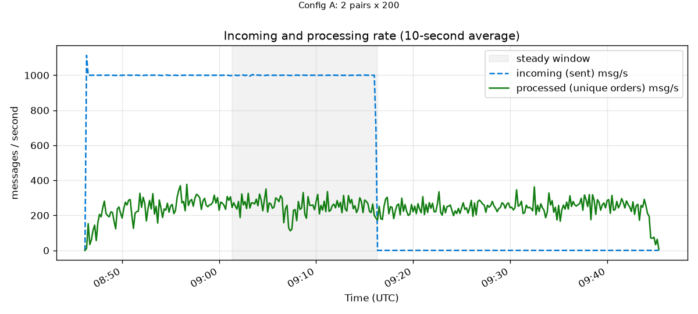
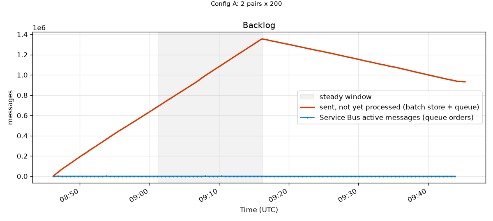
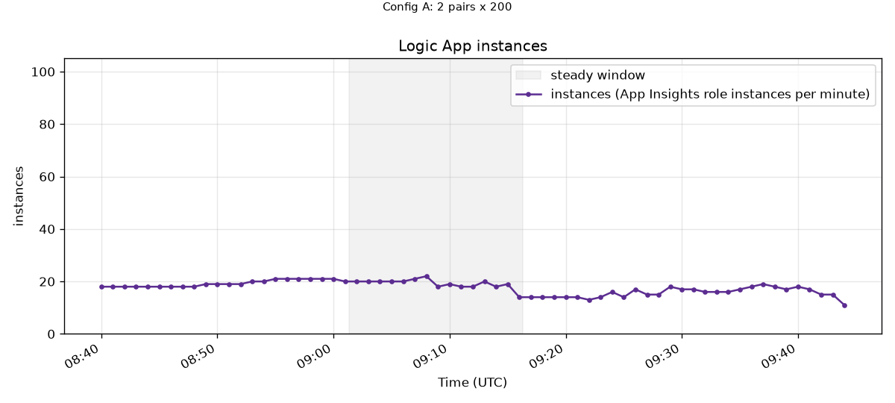
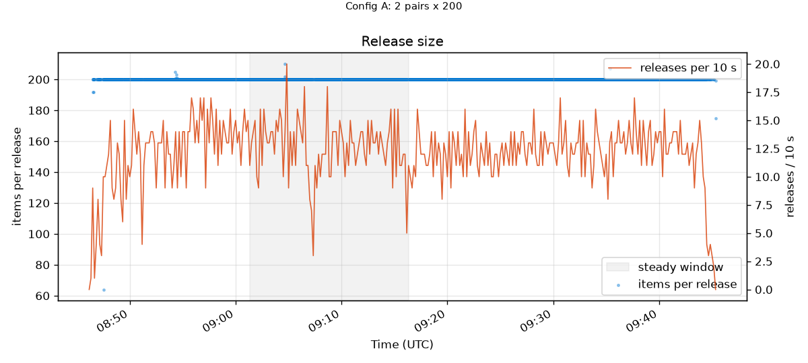

Configuration B (8 pairs x 500):

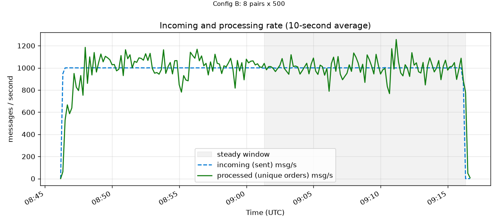
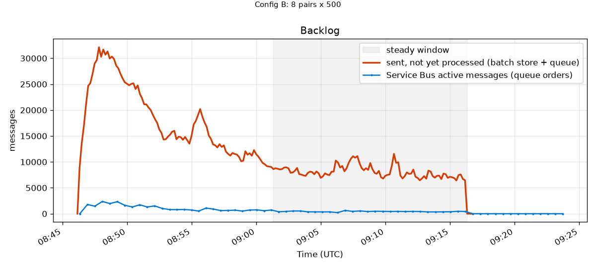
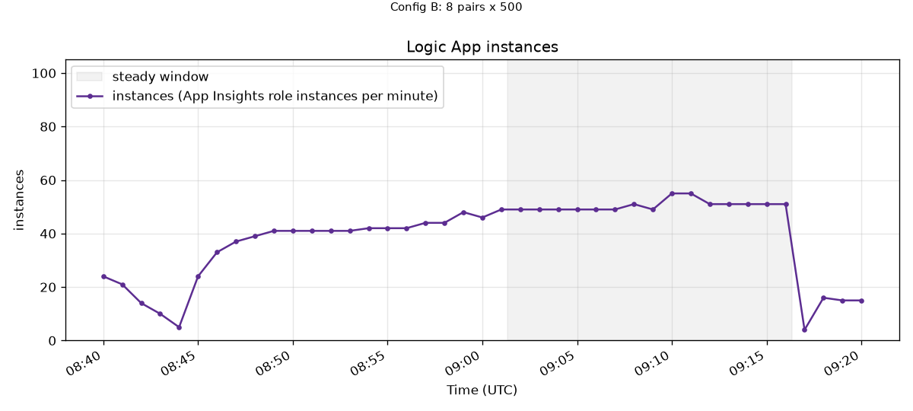
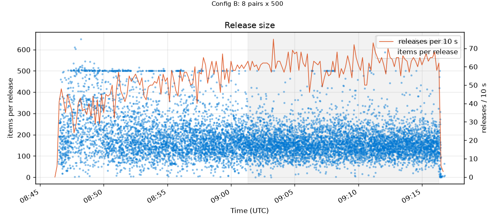

### Why each configuration gets its rate

- **A is capped by releases.** Each release is full at 200 messages. Two receivers release
  about every 1.3 s at the median, with some longer gaps, so the rate is about
  2 x 200 / 1.58 s average = 254 msg/s. CPU was not the limit: the app scaled down while the
  backlog grew.
- **B is not capped by releases.** Its ceiling is about 3,800 msg/s, so releases are partial
  (mean 181 of 500) and carry whatever has arrived. B runs at the incoming rate and uses more
  instances because it does about four times the work per second.

## High-scale round: 2,000 msg/s

This round used 4 pairs x 400 (A) and 10 pairs x 500 (B) and Service Bus 8 messaging units.
Run `run-20261128-101329`, sending from 10:13:42 to 10:43:42 UTC. The steady window is
10:28:42-10:43:42. Files are in `results/batch-sustained-rate/run-20261128-101329/config-a/`
and `config-b/`. The apps were stopped at 11:08:11; the backlog left in the batch store was
cleared afterwards.

| Metric | A: 4 pairs x 400 | B: 10 pairs x 500 |
|---|---|---|
| Messages sent | 3,599,873 | 3,599,873 |
| Incoming rate, steady window | 2,000 msg/s (sender held the rate) | 2,000 msg/s (sender held the rate) |
| Release ceiling | about 1,050 msg/s | about 4,500 msg/s |
| Processing rate, warm-up | 9.3 msg/s | 28.5 msg/s |
| Processing rate, steady window | **4.0 msg/s** | **150.8 msg/s** |
| Processing rate, after sending (24.5 min) | 462 msg/s average, at the ceiling from about 10:57 | 695 msg/s average |
| Peak processing rate (1 min) | 1,083 msg/s at 11:02 | 1,808 msg/s at 10:44 |
| Processed by the stop | 735,158 unique | 1,202,556 unique |
| Left unprocessed | about 2.86 million, in the batch store | about 2.40 million, in the batch store |
| Service Bus backlog | near 0 (ingress completes messages on start) | near 0 |
| Releases | 1,858, mean 397, p50 400 | 3,576, mean 339, p50 353 |
| Releases, steady window | 8, mean 403 | 277, mean 500 |
| Release interval per receiver | p50 1.23 s, p95 7.4 s | p50 2.76 s, p95 22 s |
| Latency, steady window (send to done) | p50 2,146 s, p95 2,355 s | p50 1,654 s, p95 2,186 s |
| Latency, all processed messages | p50 2,608 s, p95 3,028 s | p50 1,772 s, p95 2,578 s |
| Max instances | 38 | **89** |
| Plan CPU while sending | 87-96% | 87-96% |
| Failed runs | 0 | 0 |
| Duplicates | 1,735 (0.2%) | 11,095 (0.9%) |

Instances over time (max per 5 minutes, starting at 10:10):

| Config | 10:10 | 10:15 | 10:20 | 10:25 | 10:30 | 10:35 | 10:40 | 10:45 | 10:50 | 10:55 | 11:00 | 11:05 |
|---|---|---|---|---|---|---|---|---|---|---|---|---|
| A | 10 | 22 | 25 | 23 | 35 | 38 | 32 | 38 | 37 | 35 | 35 | 36 |
| B | 15 | 34 | 46 | 59 | 60 | 70 | 73 | 89 | 85 | 85 | 85 | 85 |

### High-scale charts

Configuration A (4 pairs x 400):

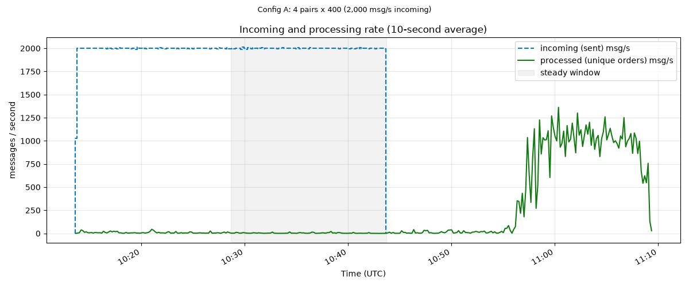
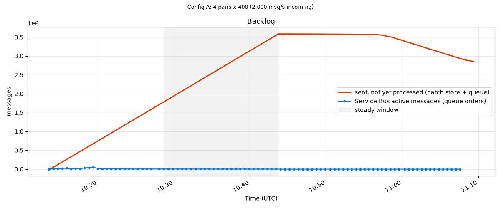
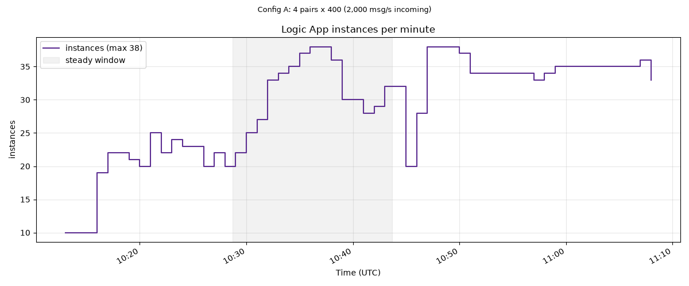
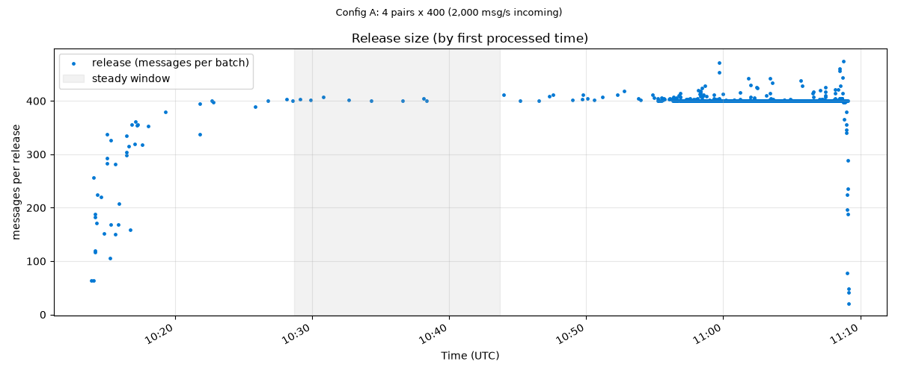

Configuration B (10 pairs x 500):

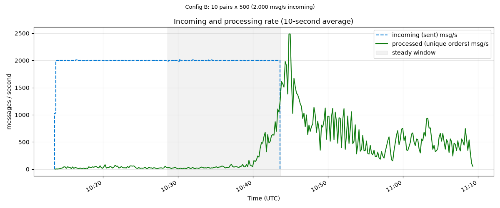
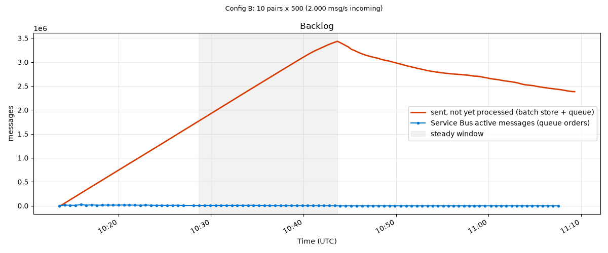
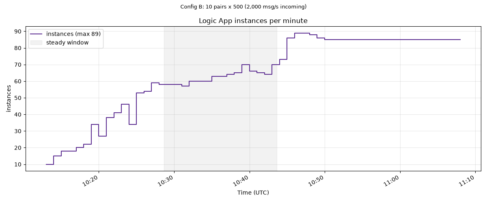
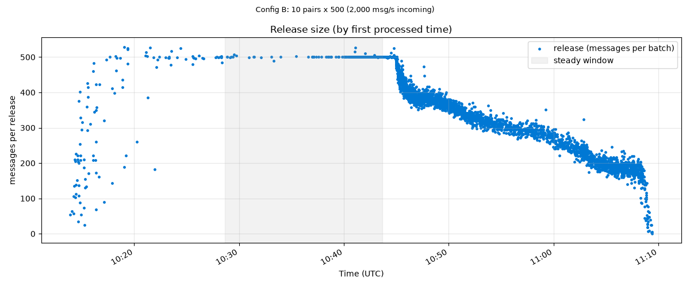

The incoming rate and the backlog come from the sender log, because App Insights only has
the send time of messages that were processed.

### High-scale round: why each configuration gets its rate

- **While sending, ingress takes the CPU.** Each message costs an ingress run and a
  `SendToBatch` call before any release happens. At 2,000 msg/s that kept the plan at
  87-96% CPU on both apps. Release jobs ran late (B's release interval p95 was 22 s) and the
  released child runs waited, so both apps processed far below their ceilings.
- **The scale controller does not see the batch store.** Ingress completes the Service Bus
  message when it starts, so the queue stayed near empty while millions of messages waited
  in the batch store. Scaling followed CPU, not the backlog. B, with more trigger and child
  work, reached 89 instances; A reached 38.
- **A is capped by releases once CPU frees up.** After sending stopped, A's releases were
  full (400) and came about every 1.5 s per receiver, so A held about 4 x 400 / 1.5 s =
  1,050 msg/s until it was stopped.
- **B is capped downstream.** B's ceiling is about 4,500 msg/s, but the child workflow
  writes each order to Cosmos DB at up to 40,000 RU/s. Cosmos DB throttled B (about 3.6
  million 429 responses per 5 minutes at the peak), and B averaged 400-1,000 msg/s with a
  1,808 msg/s peak minute.

## Run

```powershell
$env:PATH = "C:\Program Files\Microsoft SDKs\Azure\CLI2\wbin;$env:PATH"
# 1. Deploy a batch pattern app (for example batch-steady-drain) with the settings in params.json,
#    then build the app content for one configuration from it:
.\patterns\batch-sustained-rate\tools\Build-BatchApp.ps1 -OutDir .\out\app-a -Pairs 4 -Limit 400 -SourceApp <deployed app folder>
.\patterns\batch-sustained-rate\tools\Build-BatchApp.ps1 -OutDir .\out\app-b -Pairs 10 -Limit 500 -SourceApp <deployed app folder>
# 2. Send at a fixed rate and poll the queue and instances in parallel:
python .\patterns\batch-sustained-rate\tools\Send-Rate.py --namespace <ns>.servicebus.windows.net `
    --schedule warmup:2000:900,steady:2000:900 --pattern runa --log phases.json
.\patterns\batch-sustained-rate\tools\Poll-Batch.ps1 -Rg <rg> -Ns <ns> -App <app> -Out poll.csv -Minutes 60
# 3. Export the processed orders from App Insights, analyze and chart:
python .\patterns\batch-sustained-rate\tools\Batch-Analyze.py export --endpoint <ai> --pattern runa `
    --since <start> --until <end> --csv export.csv
python .\patterns\batch-sustained-rate\tools\Batch-Analyze.py analyze --csv export.csv --phases phases.json `
    --window steady --persec persec.csv --releasecsv releases.csv --out summary.json
# Sustained-Charts.py reads <prefix>-persec.csv, -poll.csv, -instances.csv, -releases.csv,
# -phases.json and -send.log from one folder:
python .\patterns\batch-sustained-rate\tools\Sustained-Charts.py <run folder> <prefix> "A: 4 pairs x 400" charts sustained-a
# 4. Scale down:
.\scripts\Set-PatternScale.ps1 -Pattern batch-steady-drain -Down
```

For `python`, use `C:\Program Files\Microsoft SDKs\Azure\CLI2\python.exe` with `PYTHONPATH`
set to `.tools\pylib`. `New-SustainedCharts.py` draws the round 1 charts from the export;
`Sustained-Charts.py` draws the round 2 charts and uses the sender log for the incoming rate.

## Notes

- **B reached 89 instances, not 100.** The scale controller reacts to the Service Bus queue
  and CPU. The queue stayed near empty, so scaling followed CPU only. A, with less work per
  second, reached 38.
- **The release ceiling is an upper bound, not a guarantee.** At 2,000 msg/s ingress used
  the CPU, and neither app reached its ceiling while messages arrived. At 1,000 msg/s (round
  1) the ceilings decided the rates. Keep the incoming rate within what the plan can ingest,
  or move ingress and processing into separate apps.
- **An empty Service Bus queue does not mean the work is done.** Millions of messages waited
  in the batch store while the queue was empty. Count processed orders in App Insights.
- **Stopping the app keeps the batch store.** Remaining messages release again when the app
  starts. Clear the batch store before a new run so old messages do not mix in.
- **Large releases can duplicate messages.** B had 0.9% duplicates in round 2 and 0.2% in
  round 1. Make the downstream idempotent.
- **Size the downstream for the ceiling.** B's drain was limited by Cosmos DB throttling,
  not by releases.
- Release intervals have a long tail on both configurations. Plan capacity from the measured
  interval, not the 1 s recurrence.