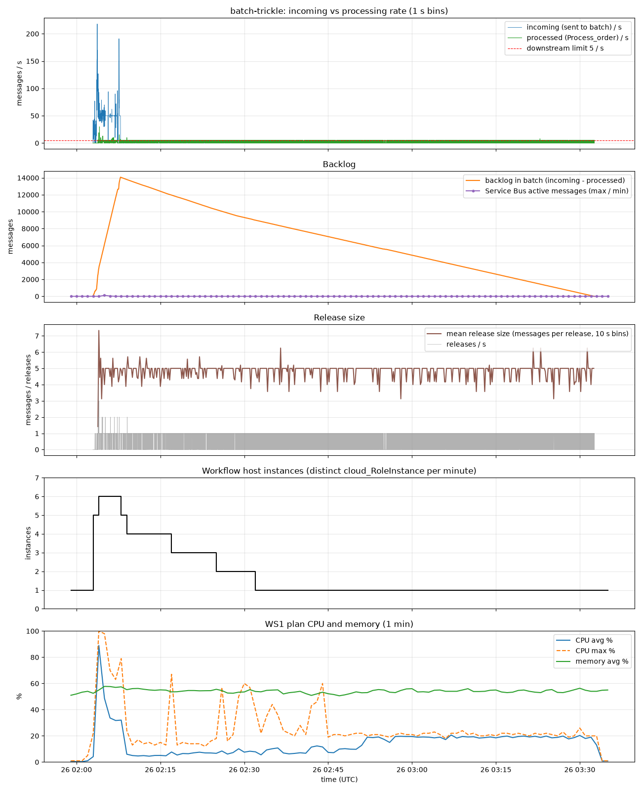
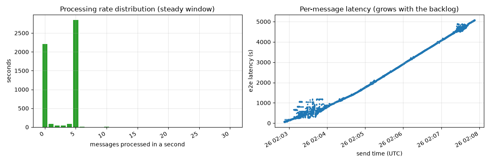

# Batch trickle: feed a fragile downstream at a fixed rate

## What it shows

A downstream service can take only about 5 calls a second, however many messages arrive.
This sample puts a Logic Apps batch between the Service Bus queue and that service. The batch
receiver releases at most 5 messages every second, so the queue backlog moves into batch
storage and the downstream sees a capped rate.

The load test sends about 50 msg/s for 5 minutes (15,000 messages), ten times the release
rate, so a backlog builds. The test then watches the drain for about 20 minutes.

## Flow

```
Locust (Azure Load Testing) --sendMessages, batches of 10, ~50 msg/s--> queue "orders"
  -> orders-ingress (stateful)
       trigger: Service Bus receiveQueueMessages (built-in), maxMessageBatchSize 100, splitOn
       Send_to_batch: SendToBatch -> orders-receiver / Batch_messages, batch "orders", partition "default"
  -> orders-receiver (stateful)
       trigger: Batch, Inline mode
                releaseCriteria: recurrence { Second, 1, messageCountLimit 5 }
       Process_batch: calls "process-batch-item" with the batch body (no retry)
  -> process-batch-item (splitOn "items", one run per message, tracked properties)
       -> shared child workflow "process-order"  (the fragile downstream)
```

`orders-ingress` takes messages off the queue as fast as it can and hands each one to the
batch. The batch stores them. Every second the receiver releases up to 5 messages, and
`process-batch-item` runs once for each, so the downstream gets at most 5 calls per release.

### Release criteria

The batch trigger accepts these `releaseCriteria` properties:

| Property | Meaning |
|---|---|
| `messageCount` | Release when this many messages are waiting. |
| `batchSize` | Release when the batch reaches this size in bytes. |
| `recurrence` | Release on a schedule: `frequency`, `interval`, `startTime`, `timeZone`. |
| `recurrence.messageCountLimit` | Upper limit on messages in one scheduled release (max 8000). |

Use `recurrence` with `messageCountLimit` for a trickle. `messageCountLimit` cannot be
combined with `messageCount` or `batchSize`. A smoke run with `messageCount` 5 plus a
1-second recurrence released about 10 a second, with bursts of 39: `messageCount` triggers a
release whenever 5 messages wait, on top of the schedule. With `messageCountLimit` 5, no
release in any run carried more than 5 messages.

A recurrence shorter than 1 minute needs the host setting
`Runtime.BatchConfiguration.MinimumRecurrenceInterval`.

## Settings (`params.json`)

| Setting | Value |
|---|---|
| Plan | WS1, `minimumElasticInstanceCount` 1, `maximumElasticWorkerCount` 20, burst 20, always-ready 1 |
| Queue `orders` | lock 5 min, max delivery 10, 5 GB, no sessions |
| Ingress trigger | `maxMessageBatchSize` 100, `splitOn` |
| Receiver trigger | Batch, `recurrence` Second/1, `messageCountLimit` 5 |
| host.json | `extensions.serviceBus.maxMessageBatchSize = 100`, `prefetchCount = 0` |
| Load | 5 users x 1 engine x 10 messages x 1 batch/s = 50 msg/s for 5 min, 20 min drain |

Host settings (`hostSettings`, written as `AzureFunctionsJobHost__extensions__workflow__settings__*` app settings):

| Host setting | Value | Why |
|---|---|---|
| `Runtime.BatchConfiguration.MinimumRecurrenceInterval` | `00:00:01` | Allows a 1-second release recurrence. The default minimum is longer. |
| `Runtime.FlowBatchTriggerReleaseJob.ExecutionInterval` | `00:00:00.100` | Checks for due releases every 100 ms, so a release is not late by a whole job interval. |
| `Runtime.FlowBatchTriggerPushJob.ExecutionInterval` | `00:00:01` | Pushes released batches to the receiver every second. |
| `Runtime.FlowBatchTriggerPushJob.DisableSafetyLimitsRelease` | `true` | Stops the runtime from releasing early when the batch store grows large. |
| `Runtime.BatchConfiguration.AllowMessageCountInRecurrence` | `true` | Allows `messageCountLimit` in the release recurrence. |

## Run

```powershell
$env:PATH = "C:\Program Files\Microsoft SDKs\Azure\CLI2\wbin;$env:PATH"
.\scripts\Deploy-Pattern.ps1     -Pattern batch-trickle
.\scripts\Invoke-LoadTest.ps1    -Pattern batch-trickle                # defaults from params.json
.\patterns\batch-trickle\tools\Get-BatchTrickleMetrics.ps1 `
    -RunId <runId> -StartUtc <loadStartUtc> -EndUtc <stopUtc>          # KQL + metrics + charts
.\scripts\Set-PatternScale.ps1   -Pattern batch-trickle -Down
```

`Get-BatchTrickleMetrics.ps1` runs the four queries in `queries\`, pulls plan and Service Bus
metrics and calls `tools\New-BatchTrickleChart.py` to draw the charts and write
`summary.json`. It needs Python with `matplotlib`.

To stop before the backlog drains, disable both workflows. Set the app settings
`Workflows.orders-receiver.FlowState=Disabled` and `Workflows.orders-ingress.FlowState=Disabled`,
then empty the queue with `tools\Clear-Queue.py` if it still holds messages. Remove those app
settings before the next run.

## Results

Run `run-20261126-020000`: westus3, WS1, up to 20 instances (burst 20), 15,050 messages sent
from 02:03 to 02:08 UTC. The test watched the whole drain; the last message was processed at
03:32:36 UTC, and no messages were left in the batch or the queue.





| Metric | Load (243 s) | Drain (5,084 s) | Whole window |
|---|---|---|---|
| Messages processed | 975 | 14,075 | 15,050 |
| Processed per second, mean | 4.01 | 2.77 | 2.83 |
| Processed per second, max | 30 | 10 | 30 |
| Coefficient of variation | 0.81 | 0.88 | 0.89 |
| Seconds above 5 | 18 | 2 | 20 |
| Seconds at exactly 5 | 149 | 2,694 | 2,843 |
| Seconds at 0 | 61 | 2,153 | 2,214 |

| Measure | Value |
|---|---|
| Incoming | 15,050 messages, peak 218/s |
| Releases | 3,133, mean size 4.80 |
| Peak backlog (batch + queue) | 14,075; 0 at the end |
| End-to-end latency (enqueue to processed) | p50 2,188 s, p95 4,797 s, p99 5,027 s, max 5,084 s |
| CPU | average 14%, max 100% (89% average in the first load minute) |
| Memory | average 54%, max 66% |
| Instances | up to 6 |
| Failed runs, duplicates, dead letters | 0, 0, 0 |

| Workflow | Runs | Duration p50 | Duration p95 |
|---|---|---|---|
| orders-ingress | 15,050 | 206 ms | 10.6 s |
| orders-receiver | 3,010 | 70 ms | 111 ms |
| process-batch-item | 15,050 | 156 ms | 207 ms |
| process-order | 15,050 | 94 ms | 133 ms |

Compared with the earlier run (`run-20261125-231224`, one instance, stopped with about 12,400
messages still in the batch):

| Measure | One instance | Up to 20 instances |
|---|---|---|
| Drain rate, mean | 2.70/s | 2.77/s |
| Processed in the load phase | 60 | 975 |
| Messages left at the end | about 12,400 | 0 |
| Latency p50 / p95 | 1,033 s / 1,446 s (partial) | 2,188 s / 4,797 s (full drain) |
| CPU average / max | 43% / 99% | 14% / 100% |

The earlier latency covers only the messages that drained before the test stopped, so it is
lower than the full-drain figure.

### What happened

- **The drain finished.** All 15,050 messages were processed in about 85 minutes, with no
  failures, duplicates or dead letters.
- **Scale-out fixed the load-phase starvation.** Releases kept running during the burst:
  975 messages were processed in the load phase, compared with 60 on one instance.
- **The rate is still about 2.8/s, not 5/s.** During the drain, the per-second count is 5 or 0
  (2,694 and 2,153 seconds), as on one instance. About 40-50 releases land each minute
  instead of 60. Extra instances do not help, because one batch trigger releases on one
  schedule. The release cadence, not compute, limits the rate.
- **The cap mostly held.** The mean release was 4.8 messages. In the drain, only 2 of 5,084
  seconds were above 5 (8 and 10), which means two releases landed in the same second. During
  the load phase, 18 seconds were above 5, with a peak of 30 at 02:04:07 while the plan scaled
  out. The downstream sees short bursts above the cap at the start of a burst.
- **Latency is the price.** At 2.8/s, the 15,000-message burst takes about 85 minutes to drain;
  a message waits a median of 36 minutes.
## Notes

- The backlog lives in batch storage, not in Service Bus. The queue showed 0 active messages
  from about 23:22, while thousands of messages still waited in the batch. Purging the queue does not
  clear them; disable `orders-receiver` (or delete and redeploy the workflow) to stop the drain.
- App Insights logs two request rows with the same id for each `Process_batch` action. Count
  releases with `dcountif(operation_Id, ...)`, as `queries\per-second-rates.kql` does.
- `first`, `last` and `kind` are reserved words in KQL; do not use them as column names.
- App Insights telemetry lags 2-5 minutes; wait before exporting.
- `Deploy-Pattern.ps1` does not start a stopped app. `Set-PatternScale.ps1 -Down` stops it, so
  start the app before the next run.
