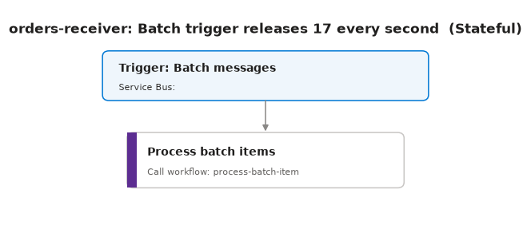
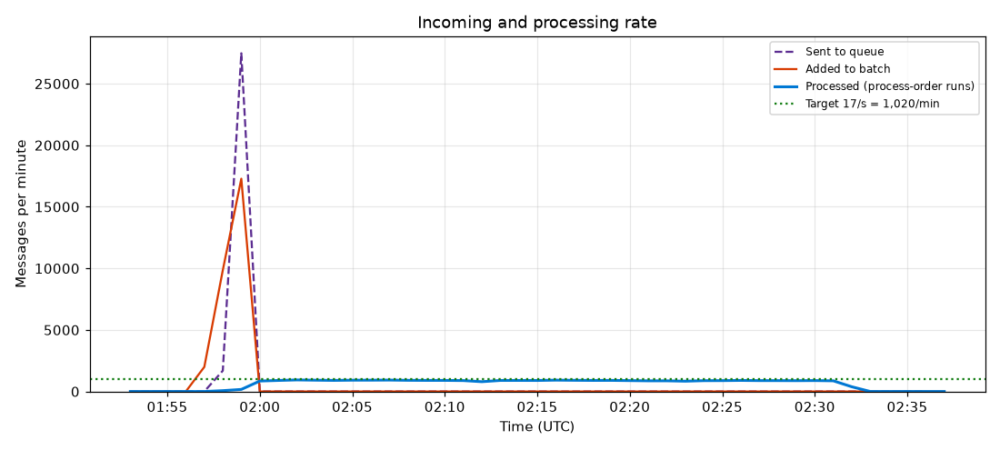
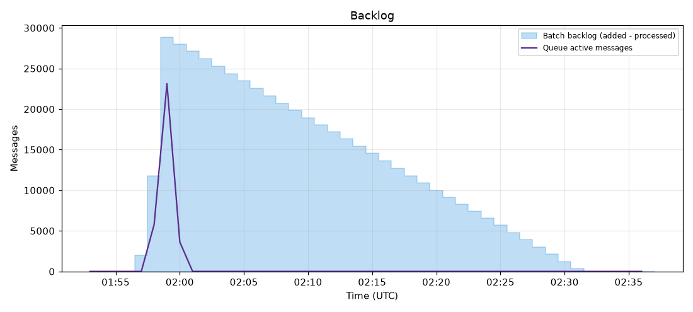
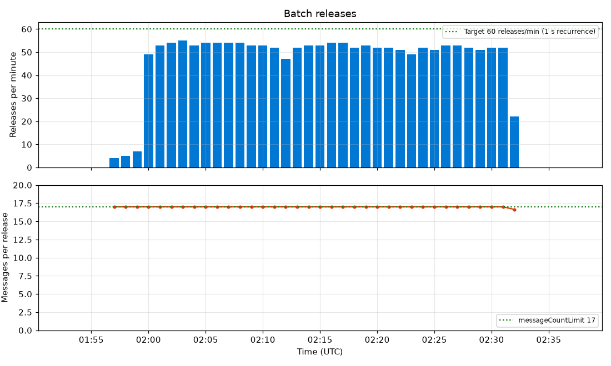
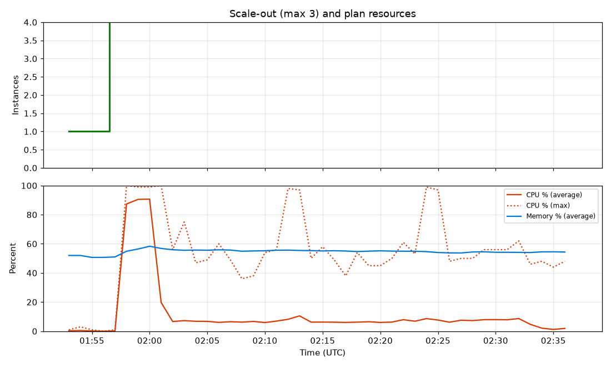
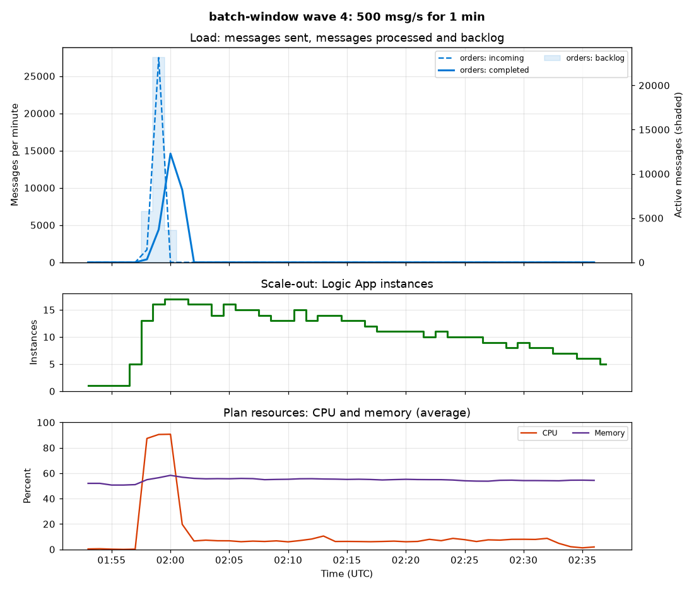

# Batch window: spread a backlog over a time window

## What it shows

How to drain a large backlog at a gentle, even rate, so a downstream service never sees a
burst. About 30,000 orders arrive at once. A Batch trigger releases a fixed number of them
every second, aiming to spread the backlog over 30 minutes.

The run shows that the release rate is very flat once the backlog sits in the batch. It also
shows the two costs that stretch the window: moving messages from Service Bus into the batch,
and the gap between releases.

## Flow

```
Locust (Azure Load Testing) --sendMessages, batches of 10--> queue "orders"
  -> orders-ingress (stateful)
       trigger: Service Bus receiveQueueMessages (built-in), splitOn, maxMessageBatchSize 100
       Send_to_batch: SendToBatch -> orders-receiver / batch "orders" / partition "default"
  -> orders-receiver (stateful)
       trigger: Batch (Inline), release every 1 s, at most 17 messages per release
       Process_batch_items: calls child "process-batch-item" (synchronous, DisableAsyncPattern)
  -> process-batch-item (stateless)
       handles the 17 items of one release
```



The backlog lives in the batch store, not in the queue. Once `orders-ingress` has moved the
messages, the `orders` queue shows 0 even though thousands of messages still wait for release.

## Sizing formula

```
messageCountLimit = ceil(backlog x releaseCadenceSeconds / windowSeconds)
```

For 30,000 messages over 1,800 s at a 1 s cadence, `messageCountLimit` = 17. This sample uses
that value.

The real cadence is longer than the configured interval. On one WS1 instance, releases came
about every 1.67 s (36 a minute), because each release waits for the release job and the
synchronous child call. Measure the cadence first, then size. With a 1.67 s cadence, a
30-minute window needs `messageCountLimit` = 28.

The runtime caps each value at 8,000.

## Release criteria

The runtime accepts these properties under `releaseCriteria`:

| Property | Meaning |
|---|---|
| `recurrence.frequency`, `recurrence.interval` | How often a release fires. |
| `recurrence.messageCountLimit` | The most messages one recurrence release takes. This is the property that spreads a backlog. |
| `messageCount` | A count threshold: release when this many messages wait. |
| `batchSize` | A size threshold in bytes. |

Validation rejects `messageCountLimit` together with `messageCount` or `batchSize`. A
recurrence with no `messageCountLimit` releases the whole backlog at once.

## Settings (`params.json`, `host.json`)

| Setting | Value |
|---|---|
| Plan | WS1, `minimumElasticInstanceCount` 1, `maximumElasticWorkerCount` 20, runtime scale monitoring on |
| Queue `orders` | lock 5 min, max delivery 10, 5 GB, no sessions |
| Ingress trigger | `maxMessageBatchSize` 100, `splitOn` |
| Batch trigger | recurrence 1 s, `messageCountLimit` 17 |
| host.json | `extensions.serviceBus.maxMessageBatchSize = 100`, `prefetchCount = 0` |
| Load | 50 users x 1 engine x 10 messages x 1 batch/s for 1 min, about 30,000 messages |

### Host settings

A 1-second release needs these runtime host settings (`params.json` `hostSettings`):

| Setting | Value | Default | Why |
|---|---|---|---|
| `Runtime.BatchConfiguration.MinimumRecurrenceInterval` | `00:00:01` | 1 min | Allows a 1 s recurrence. |
| `Runtime.FlowBatchTriggerReleaseJob.ExecutionInterval` | `00:00:00.100` | longer | Checks release criteria often enough for a 1 s cadence. |
| `Runtime.FlowBatchTriggerPushJob.ExecutionInterval` | `00:00:01` | longer | Pushes batched messages promptly. |
| `Runtime.FlowBatchTriggerPushJob.DisableSafetyLimitsRelease` | `true` | `false` | Stops the safety limit from releasing a large backlog in one go. |

## Run

```powershell
$env:PATH = "C:\Program Files\Microsoft SDKs\Azure\CLI2\wbin;$env:PATH"
.\scripts\Deploy-Pattern.ps1     -Pattern batch-window
.\patterns\batch-window\tools\Reset-Queue.ps1                     # optional: empty the queue
.\scripts\Invoke-LoadTest.ps1    -Pattern batch-window            # preload, then 36 min drain
.\scripts\Export-Results.ps1     -Pattern batch-window
.\patterns\batch-window\tools\Run-Queries.ps1                     # batch-specific KQL -> custom\
.\scripts\Export-PlanMetrics.ps1 -Pattern batch-window            # CPU and memory
# Charts: patterns\batch-window\tools\New-BatchCharts.py <runFolder>
.\scripts\Set-PatternScale.ps1   -Pattern batch-window -Down
```

For a smoke test, run `tools\send-smoke.py` to send a few messages, then check that
`orders-receiver` releases groups of at most 17.

The queries in `queries\` read per-minute batch, release and processing counts:
`batch-timeline`, `release-size`, `timeline-per-minute`, `processing-rate`, `completion-time`
and `instance-minutes`.

## Results

Run `run-20261126-015405`, westus3, WS1, runtime scale monitoring on, burst limit 20. Files
are in `results/batch-window/run-20261126-015405/`.

| Metric | Value |
|---|---|
| Backlog | 29,130 messages processed (29,160 sent) in about 1 min from 01:57:00Z |
| Target window | 30 min (17 per release, 1 s recurrence) |
| Last message processed | 02:32:26Z, 35.4 min after the first send |
| Ingest into the batch | 01:57-01:59Z, about 3 min |
| Releases | 1,714, every one 17 messages (the last one smaller) |
| Steady rate (33 min) | mean 869/min (14.5/s), max 942, coefficient of variation 14.8% |
| Releases a minute | 52-55 (one every 1.1 s) |
| Batch run duration | p50 0.69 s, p95 0.98 s, p99 5.0 s |
| End-to-end latency (send to processed) | p50 1,104 s (18.4 min), p95 1,988 s (33.1 min) |
| Peak `orders` queue backlog | 23,130 |
| Instances | up to 17 a minute, 475 instance-minutes |
| CPU (plan average) | 59% during ingest, 10% during release; peak 100% on the busiest instance |
| Memory | peak 67%, average 55% during release |
| Failures | 0 failed runs, 0 failed actions, 0 dead letters |

Compared with the earlier single-instance run (`run-20261125-230148`):

| Metric | 1 instance | Scale-out |
|---|---|---|
| Instances | 1 | up to 17 |
| Ingest into the batch | 21.5 min | about 3 min |
| Steady rate | 10.2/s | 14.5/s |
| Batch run duration p50 | 1.95 s | 0.69 s |
| Last message processed | 69 min | 35.4 min |
| End-to-end p95 | 65.8 min | 33.1 min |
| Largest release | 17 | 17 |

### Charts

| Chart | File |
|---|---|
| Incoming (batched) vs processing rate |  |
| Backlog in the batch and in the queue |  |
| Release size |  |
| Instances, CPU and memory |  |
| Timeline |  |

The kit's standard charts (`throughput.png`, `run-latency.png`, `e2e-latency.png`,
`queue-backlog.png`, `instances.png`, `failures.png`) are in the same folder.

### What happened

- The cap held. Every minute's largest release was 17 messages, across 1,714 releases.
- The plan scaled to 17 instances within 3 minutes of the first send. With runtime scale
  monitoring on, the scale controller saw the ingest work and added instances.
- Ingest took about 3 minutes instead of 21.5, so the window started almost on time.
- The release rate was flat at about 14.5 messages a second, not the planned 17. Releases
  came every 1.1 s. Each release starts a stateful run that waits for the child workflow,
  and the release job adds its own delay.
- During the release phase the plan averaged 10% CPU. The extra instances were mostly idle:
  one release job sets the pace, so more instances do not raise the release rate.
- The window still finished in 35 minutes, close to the 30-minute target.
## Notes and lessons

- Preload the batch before the window starts, or start the window clock when ingest ends.
  The ingest workflow, not the release, sets the start time.
- Budget the ingest rate. One WS1 instance moved about 23 messages a second into the batch
  with `splitOn` and one `SendToBatch` per message. Scaled out to 17 instances, ingest reached
  about 290 a second.
- Expect one release about every 1.1 s (about 14.5 messages a second at 17 per release) with a
  1 s recurrence and a synchronous child call. Raise `messageCountLimit` rather than shorten the recurrence.
- Watch the batch, not the queue. The `orders` queue drops to 0 long before the work is done.
  Use `queries\batch-timeline.kql` to see the batch backlog.
- Turn on runtime scale monitoring so ingest scales out. Extra instances speed up ingest and
  child runs, but one release job still sets the release rate.
- The child workflow is stateless, so it has no run history. Its actions still appear in
  App Insights.
