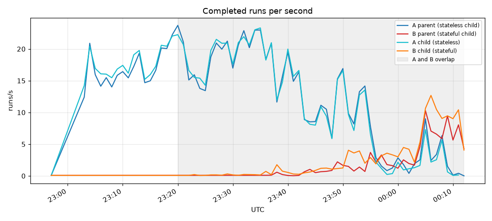
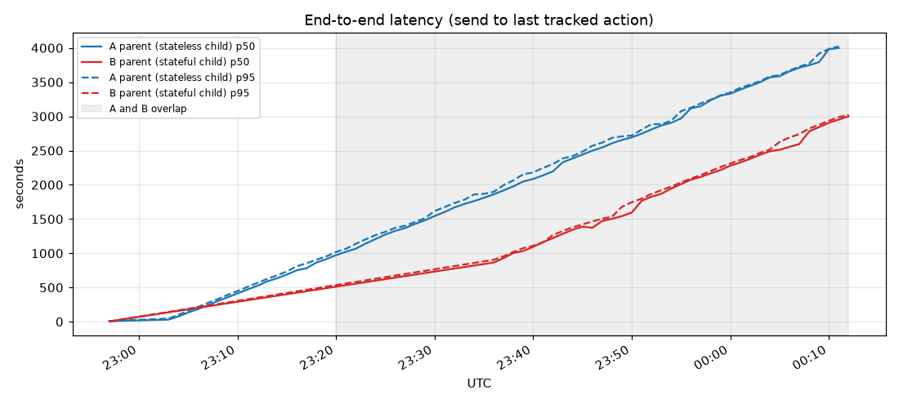
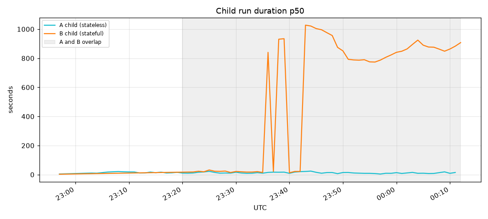
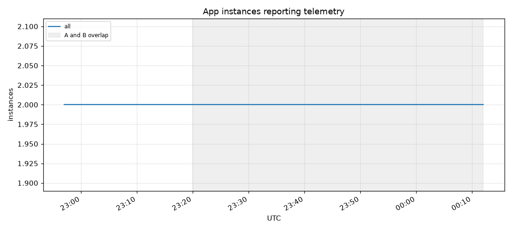
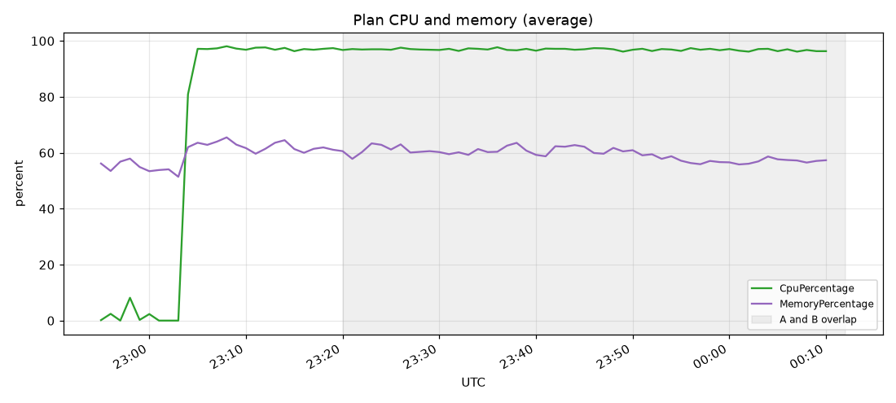
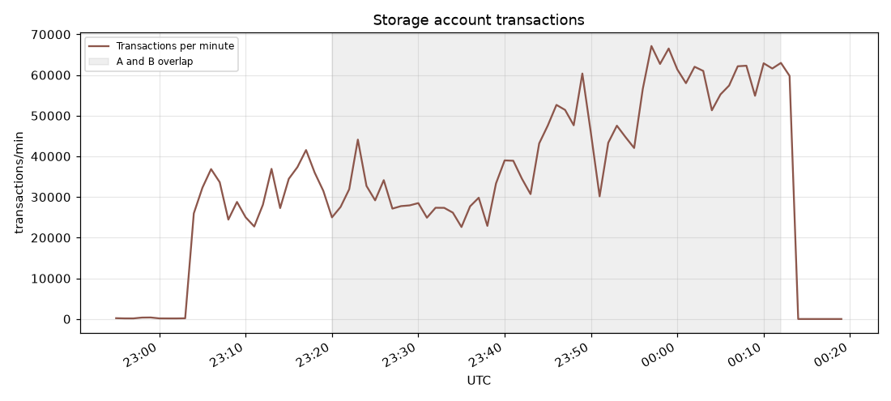

# Child type: stateless or stateful child workflow

## What it shows

Should the child workflow be stateless or stateful? This sample uses the
[1a-max-throughput](../1a-max-throughput/README.md) parent design (Stateful,
Service Bus trigger with `splitOn`, no concurrency limit) and changes only the
child:

| Variant | Queue | Parent workflow | Child workflow | Child kind |
|---|---|---|---|---|
| A | `orders-a` | `orders-stateless-child` | `process-order` (shared) | Stateless |
| B | `orders-b` | `orders-stateful-child` | `process-order-stateful` | Stateful |

`process-order-stateful` has the same actions as `shared/logicapp/process-order`;
only `kind` differs. Both variants run in one Logic App on the same WS1 plan
(2 to 10 instances).

## Flow

```text
load test ──► Service Bus queue (orders-a | orders-b)
                    │  splitOn: one run per message
                    ▼
        Parent (Stateful) ──► Child: process-order (Stateless)        [A]
                          └─► Child: process-order-stateful (Stateful) [B]
                    │
                    ▼
        Complete message, track end-to-end latency
```

A stateless child keeps its actions in memory and returns when done. A
stateful child writes each action's inputs, outputs and state to storage and
runs through the storage-backed job queue, like the parent.

## Settings (`params.json`)

| Setting | Value | Why |
|---|---|---|
| Plan | WS1, 2 always-ready, max burst 10 | Same as 1a |
| Trigger | Service Bus, `splitOn`, no concurrency limit | Same as 1a |
| `loadTest.queueName` | `orders-a` or `orders-b` | Selects the variant to load |
| `measurement.workflowName` | `orders-stateless-child` or `orders-stateful-child` | Selects the parent to measure |
| Load | about 50,000 messages at about 300 msg/s | Same load for A and B |

The checked-in `params.json` targets variant A. To run B, set `loadTest.queueName` to
`orders-b` and `measurement.workflowName` to `orders-stateful-child`.

## Run

```powershell
./scripts/Deploy-Pattern.ps1 -Pattern child-type
./scripts/Invoke-LoadTest.ps1 -Pattern child-type          # variant A
./scripts/Export-Results.ps1 -Pattern child-type
# Edit params.json for variant B (see above), then:
./scripts/Invoke-LoadTest.ps1 -Pattern child-type
./scripts/Export-Results.ps1 -Pattern child-type
./scripts/Set-PatternScale.ps1 -Pattern child-type -Down
```

Charts: `python results/child-type/run-20261125-230008/comparison/make_charts.py`
(needs matplotlib) reads the CSVs in that folder.

## Results

### Clean A vs B (B rerun alone, 26 November 2026)

B was rerun alone in [`run-20261126-014614`](../../results/child-type/run-20261126-014614/).
Before the load started, all leftover runtime state and queue messages were
cleared, so no wave 3 backlog ran with it. A is the wave 3 run
[`run-20261125-230008`](../../results/child-type/run-20261125-230008/), which ran
alone until B started. Both used the same load: about 54,000 messages at 300
msg/s for 3 minutes.

| Measure | A: stateless child | B: stateful child |
|---|---|---|
| Messages sent | 53,890 | 53,900 |
| Parent runs finished / failed | 53,592 at export / 0 | 53,916 / 0 |
| Instances | 2 (max burst 10) | 19-20 (max burst 20) |
| Parent throughput | 15-19 runs/s | about 99 runs/s (01:50-01:59), peak 284 runs/s |
| Parent throughput per instance | about 8.5 runs/s | about 5 runs/s |
| End-to-end latency p50 / p95 | 1,405 s / 2,898 s | 352 s / 454 s |
| Parent run duration p50 / p95 | 754 s / 1,760 s | 244 s / 339 s |
| Child run duration p50 / p95 | 14.3 s / 31.9 s | about 147 s / 232 s |
| CPU avg / max during load | 85.5% / 98.1% | 91.8% / 100% |
| Memory avg / max during load | 61.3% / 65.5% | 60.3% / 78% |
| First send to last run finished | about 53 min (estimated from throughput) | 1,114 s (most runs done in 9 min) |

B's child durations are run-weighted averages of per-minute percentiles.
B finished faster only because the plan scaled out to 20 instances, where A
stayed at 2. Compare per instance: the stateless child still moved about 1.7
times as many parent runs per instance, and its child runs took seconds, not
minutes. B had 5 failed `Process_order` actions, but no parent run failed.

Charts: [throughput](../../results/child-type/run-20261126-014614/throughput.png),
[latency](../../results/child-type/run-20261126-014614/e2e-latency.png),
[instances](../../results/child-type/run-20261126-014614/instances.png),
[timeline](../../results/child-type/run-20261126-014614/timeline.png).

### Wave 3 (overlapping runs, 25-26 November 2026)

Runs on 25-26 November 2026, westus3. A: 53,890 messages sent, run
`run-20261125-230008`. B: 54,020 messages sent, run `run-20261125-231852`.
The B run is superseded by `run-20261126-014614`: it overlapped A and only
10,138 runs finished before export. All finished runs succeeded.

| Measure | A: stateless child | B: stateful child |
|---|---|---|
| Parent throughput, variant alone | 15-19 runs/s | about 10 runs/s |
| Parent throughput, while sharing the app | (A finishing) | 1-4.5 runs/s |
| End-to-end latency p50 / p95 | 1,405 s / 2,898 s | 2,537 s / 2,968 s (partial) |
| Child run duration p50 / p95 | 14.3 s / 31.9 s | 869 s / 1,675 s (partial) |
| Parent run duration p50 / p95 | 754 s / 1,760 s | 1,925 s / 2,578 s (partial) |
| Storage transactions per minute | 27,954 (A alone) | 43,084 (A and B together) |
| CPU avg / max | 85.5% / 98.1% | 96.8% / 97.1% (B alone) |
| Memory avg / max | 61.3% / 65.5% | 57.4% / 59.0% (B alone) |
| Instances | 2 | 2 |
| Child run history | None (run list is empty) | Every run and action |
| Parent runs finished at export | 53,592 | 10,138 of 54,020 |

Total storage transactions from 22:55 to 00:20 UTC: 2.87 million, peaking at
67,119 per minute.








### What changed and what did not

- The stateful child roughly halved parent throughput on the same CPU-bound
  plan, from 15-19 to about 10 runs/s.
- Child run duration rose from seconds to minutes. Stateful child runs wait in
  the same storage job queue as the parent runs that call them.
- Storage transactions rose: each stateful child action is a storage write.
- In wave 3, CPU stayed at about 95% and the plan stayed at 2 instances, so the
  plan, not Service Bus, set the limit. In the B rerun alone, with max burst 20,
  the plan scaled out to 20 instances and B drained in about 19 minutes.
- Only the stateful child keeps run history you can open in the portal.

## Conclusion

Use a **stateless** child when it is small and all-or-nothing. If it fails,
let the parent retry it. It is cheaper and moved about 1.7 times as many runs
per instance here.

Use a **stateful** child when you need per-step run history, or the child is
long-running and must survive a restart. Expect lower throughput and more
storage transactions.

## Notes

- The runs overlapped. `splitOn` completes each message when it creates the
  run, so the queue drains long before the runs finish. The load test's fixed
  drain ended A's export early, and B started while A's backlog was still
  running. The B figures marked "partial" cover the runs finished before
  export; the "variant alone" rows use the minutes when only one variant ran.
- The plan did not scale out beyond 2 instances despite about 95% CPU.
- Always-ready instance provisioning took about 3.5 minutes inside the
  measured window.
- After the wave 3 export, about 44,000 B runs stayed pending in storage. They
  were cleared before the B rerun, which ran alone.
- The B rerun used max burst 20; A used max burst 10 and stayed at 2 instances.
  Compare the two per instance, not by wall-clock time.
