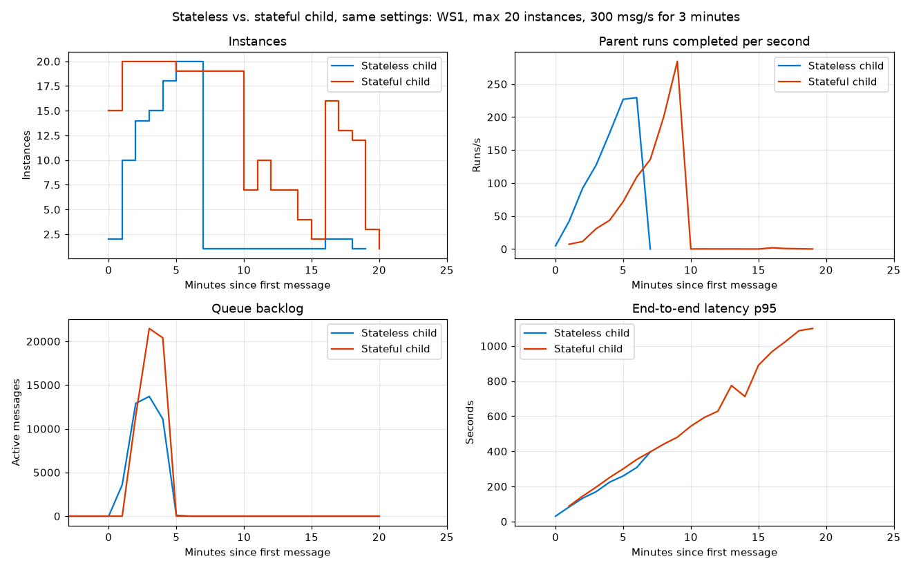

# Child type: stateless or stateful child workflow

## What it shows

Should the child workflow be stateless or stateful? This sample uses the
[1a-max-throughput](../1a-max-throughput/README.md) parent design (Stateful,
Service Bus trigger with `splitOn`, no concurrency limit) and changes only the
child:

| Variant | Queue | Parent workflow | Child workflow | Child kind |
|---|---|---|---|---|
| A | `orders-a` | `orders-stateless-child` | `process-order` (shared) | Stateless |
| B | `orders-b` | `orders-stateful-child` | `process-order-stateful` | Stateful |

`process-order-stateful` has the same actions as `shared/logicapp/process-order`;
only `kind` differs. Both variants run in one Logic App on the same WS1 plan
(2 always-ready, up to 20 instances).

## Flow

```text
load test ──► Service Bus queue (orders-a | orders-b)
                    │  splitOn: one run per message
                    ▼
        Parent (Stateful) ──► Child: process-order (Stateless)        [A]
                          └─► Child: process-order-stateful (Stateful) [B]
                    │
                    ▼
        Complete message, track end-to-end latency
```

A stateless child keeps its actions in memory and returns when done. A
stateful child writes each action's inputs, outputs and state to storage and
runs through the storage-backed job queue, like the parent.

## Settings (`params.json`)

| Setting | Value | Why |
|---|---|---|
| Plan | WS1, 2 always-ready, max 20 instances, runtime scale monitoring on | Same for A and B |
| Trigger | Service Bus, `splitOn`, no concurrency limit | Same as 1a |
| `loadTest.queueName` | `orders-a` or `orders-b` | Selects the variant to load |
| `measurement.workflowName` | `orders-stateless-child` or `orders-stateful-child` | Selects the parent to measure |
| Load | about 50,000 messages at about 300 msg/s | Same load for A and B |

The checked-in `params.json` targets variant A. To run B, set `loadTest.queueName` to
`orders-b` and `measurement.workflowName` to `orders-stateful-child`.

## Run

```powershell
./scripts/Deploy-Pattern.ps1 -Pattern child-type
./scripts/Invoke-LoadTest.ps1 -Pattern child-type          # variant A
./scripts/Export-Results.ps1 -Pattern child-type
# Edit params.json for variant B (see above), then:
./scripts/Invoke-LoadTest.ps1 -Pattern child-type
./scripts/Export-Results.ps1 -Pattern child-type
./scripts/Set-PatternScale.ps1 -Pattern child-type -Down
```

Run A and B one after the other, never at the same time, and with the same
plan settings. Scale the app down and clear leftover runs between them.

## Results

A and B ran alone, one after the other, with the same settings: WS1,
2 always-ready, max 20 instances, runtime scale monitoring on, and about
54,000 messages at 300 msg/s for 3 minutes. Region westus3.

- A: [`run-20261128-064144`](../../results/child-type/run-20261128-064144/), 28 November 2026
- B: [`run-20261126-014614`](../../results/child-type/run-20261126-014614/), 26 November 2026

| Measure | A: stateless child | B: stateful child |
|---|---|---|
| Messages sent | 53,930 | 53,900 |
| Parent runs finished / failed | 53,930 / 0 | 53,916 / 0 |
| Peak instances | 20 | 20 |
| Peak parent runs/s | 229 | 284 |
| Average msg/s, first send to last run finished | 130.9 | 48.4 |
| First send to last run finished | 412 s | 1,114 s |
| Queue backlog peak | 13,690 | 21,465 |
| End-to-end latency p50 / p95 / p99 | 153 s / 284 s / 311 s | 352 s / 454 s / 493 s |
| Parent run duration p50 / p95 | 88 s / 180 s | 244 s / 339 s |
| Child call (`Process_order`) p50 / p95 | 13 s / 32 s | 40 s / 249 s |
| Storage transactions, whole run | 1.16 million | 5.58 million |
| Child run history | None | Every run and action |

B had 5 failed `Process_order` actions that the parent retried; no parent run
failed.



## Conclusion

With the same settings, the stateless child finished all the work about 2.7
times sooner and used about a fifth of the storage transactions. Both variants
reached 20 instances and both queues emptied within about 5 minutes. The
stateful child runs then waited in the same storage job queue as the parents
that called them, so the last runs finished about 18 minutes after the first
message.

Use a **stateless** child when it is short and all-or-nothing. If it fails,
let the parent retry it.

Use a **stateful** child when you need run history for each child run, or the
child is long-running and must survive a restart. Expect more storage load and
a longer tail.

## Earlier runs

Earlier runs on 25 November 2026 (`run-20261125-230008`,
`run-20261125-231852`) used different scale settings for A and B, and B
overlapped A. Don't compare them. They're kept for reference only.
