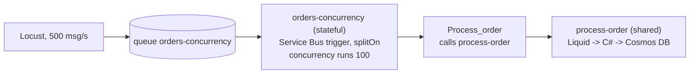
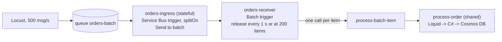

# Concurrency vs batch: two ways to control throughput

## What it shows

At high load, how does a Service Bus trigger with trigger concurrency at its limit compare with
the batch trigger for controlling throughput? Both designs run in one Logic Apps Standard app on
the same WS1 plan (2 to 10 instances) and get the same load: about 119,000 messages sent at about
500 msg/s for 3 minutes, then a 10-minute drain. The runs went one after the other, each on its
own queue, with the other design's trigger turned off.

## Flow

### A: trigger concurrency 100



### B: batch trigger (1 s, 200)



In A, the runtime holds at most 100 runs at once and leaves the rest of the messages on the queue.
In B, the ingress workflow moves messages off the queue into the batch store, and each release
starts one `process-batch-item` run per item. Nothing caps how many of those runs exist at once.

## Settings (`params.json`, `host.json`)

| Setting | Value |
|---|---|
| Plan | WS1, `minimumElasticInstanceCount` 2, `maximumElasticWorkerCount` 10 |
| Queues | `orders-concurrency`, `orders-batch`: lock 5 min, max delivery 10, 5 GB |
| host.json | `serviceBus.maxMessageBatchSize` 100, `prefetchCount` 0 |
| A trigger | `runtimeConfiguration.concurrency.runs` 100 (`Runtime.Trigger.MaximumRunConcurrency` default) |
| B release | `releaseCriteria`: `messageCount` 200, `recurrence` every 1 second |
| B host settings | `Runtime.BatchConfiguration.MinimumRecurrenceInterval` 00:00:01, release job every 100 ms, push job every 1 s, `DisableSafetyLimitsRelease` true |
| Load | 50 users x 10 messages x 1 batch/s = 500 msg/s for 3 min, 10 min drain |

The batch trigger accepted these release criteria: `messageCount`, `batchSize` (bytes) and
`recurrence` (`frequency`, `interval`, `startTime`, `timeZone`, `schedule`, `messageCountLimit`).
`messageCountLimit` cannot be combined with `messageCount` or `batchSize`. `recurrence.count`
is rejected.

## Run

```powershell
$env:PATH = "C:\Program Files\Microsoft SDKs\Azure\CLI2\wbin;$env:PATH"
$p = "concurrency-vs-batch"
.\scripts\Deploy-Pattern.ps1 -Pattern $p

# 1. Pick a design: in params.json set loadTest.queueName and measurement.workflowName
#    (A: orders-concurrency / orders-concurrency, B: orders-batch / process-batch-item).
# 2. Turn off the other design's trigger, for example for run B:
az webapp config appsettings set -g rg-msgpat-concurrency-vs-batch -n <app> `
    --settings Workflows.orders-concurrency.FlowState=Disabled
# 3. Empty the queues, then load and export.
.\patterns\concurrency-vs-batch\tools\Reset-Queue.ps1
.\scripts\Invoke-LoadTest.ps1    -Pattern $p
.\scripts\Export-Results.ps1     -Pattern $p
.\scripts\Export-PlanMetrics.ps1 -RunFolder results\$p\<runId> -ResourceGroup rg-msgpat-$p
.\patterns\concurrency-vs-batch\tools\Run-Queries.ps1 -Pattern $p -RunId <runId> `
    -StartUtc <start> -EndUtc <end>

# 4. After both runs, draw the comparison and scale down.
python patterns\concurrency-vs-batch\tools\New-ComparisonCharts.py `
    results\$p\<runA> results\$p\<runB> results\$p\comparison.png
.\scripts\Set-PatternScale.ps1 -Pattern $p -Down
```

`Reset-Queue.ps1` deletes and recreates every queue in `params.json`. Run it before each run,
because a backlog that does not drain carries into the next one.

## Results

Runs: A `run-20261125-231420`, B `run-20261125-234025`. westus3, WS1, same load.


Per-run timelines (Service Bus in/out and backlog, instances, CPU and memory):
[A](../../results/concurrency-vs-batch/run-20261125-231420/timeline.png),
[B](../../results/concurrency-vs-batch/run-20261125-234025/timeline.png).
Kit charts sit beside them (`throughput.png`, `run-latency.png`, `e2e-latency.png`,
`queue-backlog.png`, `instances.png`).

| Metric | A: concurrency 100 | B: batch (1 s, 200) |
|---|---|---|
| Messages sent | 119,100 | 119,180 |
| Taken off the queue | about 6 msg/s | about 20-65 msg/s (into the batch store) |
| Orders processed (`Process_order` ended) | 6,002 in about 17 min | about 2,077 in 23 min |
| Processing rate | 5.7-5.9 msg/s average, 6.85 peak | about 1.5 msg/s average, in bursts up to 12/s (30 s average) |
| Rate shape | Flat, dips to 3/s about every 3 min | Nothing for 10 min, then bursts and gaps |
| Runs in flight | p50 28, p95 40, max 49 | p50 809, max about 1,178 |
| Run duration | p50 0.73 s, p95 1.28 s | `process-batch-item` p50 235 s, p95 253 s |
| End-to-end latency (sent to processed) | p50 506 s, p95 984 s | p50 900 s, p95 1,021 s |
| Peak backlog | 117,489 (queue) | 119,180 (queue), then moved into the batch store |
| Instances | 2 (the minimum) | 1 reported telemetry |
| CPU | 17-28% average, 87% max | about 48% average, 97-99% max |
| Memory | 51-54% average | 53-56% average, 67% max |
| Batch releases | none | 42 |
| Failures | 0 | 0 |

Neither run drained its backlog in the window. Neither design scaled out: the elastic scaler did
not add instances for either trigger.

### What we learned

- **A gives a steady, bounded rate.** With 100 runs allowed, only about 30-50 were ever in
  flight on 2 instances. The child call, not the limit, set the pace. CPU stayed low and the
  rate stayed near 6 msg/s for the whole run. The backlog waits on the queue, where it costs
  nothing.
- **B moves the backlog, it does not control it.** The ingress workflow drains the queue faster
  than A, but each release fans out into one child run per item with no cap. More than 1,000
  runs piled up on one instance, CPU hit 99%, each run waited about 4 minutes for a worker, and
  orders came out in bursts. Throughput was lower than A and latency higher.
- **The batch trigger adds overhead.** Every message costs an ingress run, a batch store write,
  a release and a child run, on top of the work itself.

### When to use which

- Use **trigger concurrency** when you want to limit the rate into a downstream system or keep
  the app steady under a spike. Let the queue hold the backlog.
- Use the **batch trigger** when the goal is grouping: one call per group, a time window, or a
  partition. Do not use it as a throttle. If you must process items one by one after a release,
  cap the fan-out (for example a `For each` with a concurrency limit) instead of calling a
  workflow per item.

## Notes

- App Insights has no telemetry for B from 23:40 to 23:50. The app restarted after the
  `FlowState` app setting change. The B numbers start at about 23:50.
- In B, the kit summary counts `process-batch-item` runs, so its run duration is the child
  wait time, not the order processing time.
- Service Bus completed-message counts measure intake. In B they show messages moved into the
  batch store, not orders processed. The processing rate comes from `Process_order` action
  ends in the shared child.
- The `completions-per-second` query omits seconds with no completions. The comparison chart
  bins it into 30-second buckets and fills empty buckets with zero.
- `Reset-Queue.ps1` dropped about 71,000 messages still queued after run B.
- The app is scaled down (plan WS1, max burst 1, app stopped). The resource group stays.
