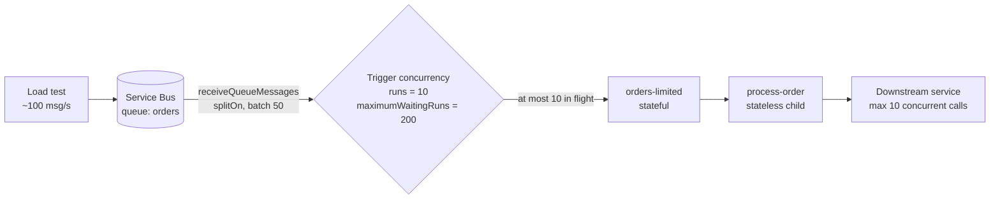
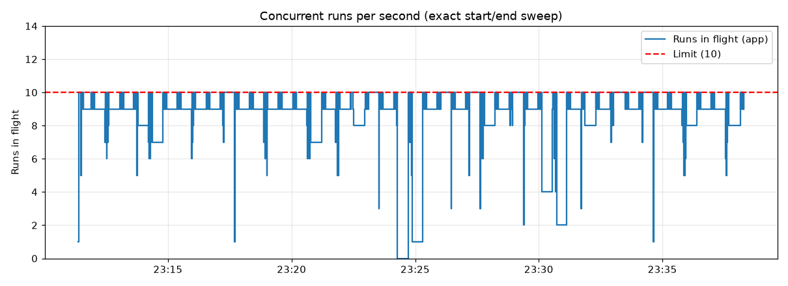
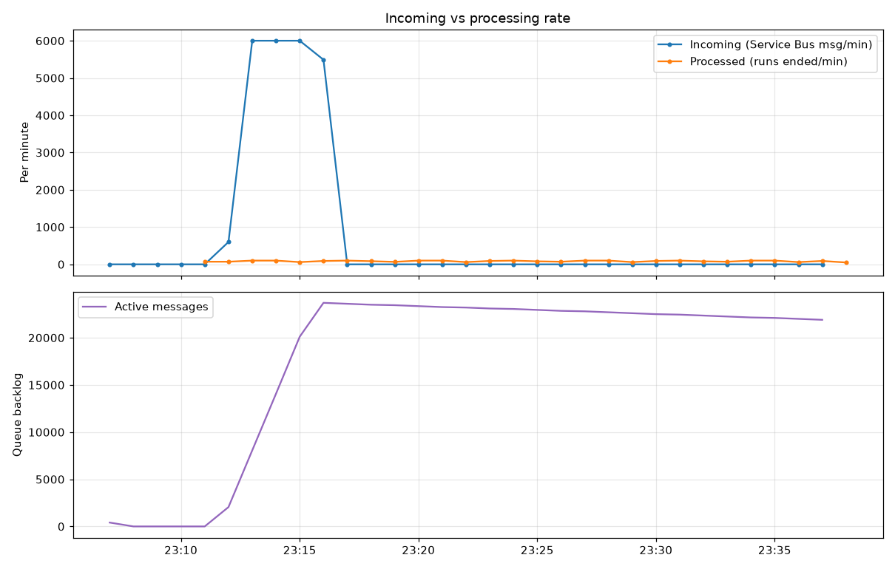
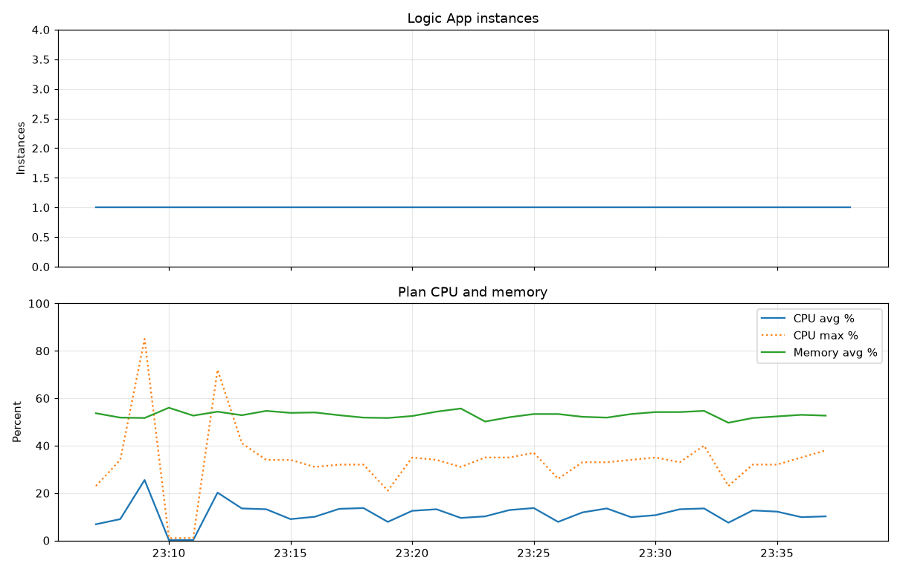

# Limit concurrent runs

## What it shows

A downstream service accepts at most 10 calls at once. The stateful workflow
`orders-limited` reads orders from a Service Bus queue and calls that service
through the shared stateless `process-order` child. Trigger concurrency
(`runtimeConfiguration.concurrency.runs = 10`) caps how many runs are in
flight. Messages beyond the cap wait in the queue, not in the downstream service.

The test sent about 24,000 messages at about 100 msg/s, far above what 10
concurrent calls can handle. The cap held at exactly 10 throughout the run.
Queue wait time absorbed the excess load.

## Flow



## Settings (`params.json`, `host.json`, `workflow.json`)

| Setting | Value | Why |
|---|---|---|
| Plan | WS1, 1 to 3 workers | Lets the app scale out so we can see whether the cap holds per app |
| Trigger | Service Bus `receiveQueueMessages`, `splitOn` | One run per message |
| `runtimeConfiguration.concurrency.runs` | 10 | The downstream limit |
| `runtimeConfiguration.concurrency.maximumWaitingRuns` | 200 | Bounds the runs that wait in the app, so the rest stay in the queue |
| `maxMessageBatchSize` (host.json) | 50 | Messages per receive call |
| `prefetchCount` (host.json) | 0 | No messages held in the client while runs wait |
| Queue lock duration | PT5M | Longer than the worst run plus wait in the app |
| Queue max delivery count | 10 | Default dead-letter threshold |
| Child | `process-order` (same body as `1a-max-throughput`) | Stands in for the downstream call |

## Run

```powershell
.\scripts\Deploy-Pattern.ps1     -Pattern limit-concurrent-runs
.\scripts\Invoke-LoadTest.ps1    -Pattern limit-concurrent-runs        # defaults from params.json
.\scripts\Export-Results.ps1     -Pattern limit-concurrent-runs        # KQL + metrics + charts
.\patterns\limit-concurrent-runs\tools\Run-Queries.ps1 -Pattern limit-concurrent-runs `
    -StartUtc 2026-11-25T23:05:00Z -EndUtc 2026-11-25T23:40:00Z -RunId <run>   # concurrency and latency queries
. .\scripts\Common.ps1; & (Get-Python) .\patterns\limit-concurrent-runs\tools\New-LimitCharts.py results\limit-concurrent-runs\<run>
.\patterns\limit-concurrent-runs\tools\Reset-Queue.ps1 -Pattern limit-concurrent-runs   # drop the leftover backlog
.\scripts\Set-PatternScale.ps1   -Pattern limit-concurrent-runs -Down
```

`New-LimitCharts.py` needs matplotlib. The kit installs it in `.tools\pylib`.

## Results

Run `run-20261125-230803`, westus3.

| Metric | Value |
|---|---|
| Messages sent | 24,090 (about 100 msg/s for about 4 minutes) |
| Runs in the 30-minute window | 2,340, all succeeded, 0 dead letters |
| Throughput | about 87 runs/min (1.45/s) on average, 1.67/s peak |
| Max runs in flight (app) | **10**; p50 9, p95 10; 0 seconds above 10 |
| Max runs in flight (one instance) | 10 |
| Run duration | p50 1,048 ms, p95 1,264 ms, p99 1,404 ms |
| Child call time | p50 211 ms, p95 292 ms |
| End-to-end latency (enqueue to run end) | p50 800 s (13.3 min), p95 1,524 s (25.4 min) |
| Peak queue backlog | 23,700 messages |
| Instances | 1 for the whole run |
| CPU | 8 to 14% average; 30 to 40% max per minute, 85% at startup |
| Memory | 50 to 56% |

Concurrent runs, measured each second from exact run start and end times:



Incoming rate against processing rate, and the queue backlog:



Instances, CPU and memory:



The kit charts are in the same folder: `throughput.png`, `run-latency.png`,
`e2e-latency.png`, `queue-backlog.png`, `instances.png` and `failures.png`.

### What changed and what did not

- The cap held. The app never had more than 10 runs in flight, and it was at
  9 or 10 for most of the run.
- The downstream saw a steady rate. The backlog grew to 23,700 messages and
  drained at about 87 per minute.
- Latency moved into the queue. Each run took about 1 second, but messages
  waited 13 to 25 minutes before their run finished.

## Notes

- **The limit is per instance, not per app.** Trigger concurrency applies on
  each worker. With 3 workers the downstream could see up to 30 calls. This run
  stayed on 1 instance, so it does not show that case. If the downstream limit
  is strict, set the plan maximum to 1 worker, or divide the limit by the
  maximum worker count.
- **No scale-out happened.** The scale controller logged "Failed to initialize
  scale monitoring for 'orders-limited' function." The app stayed on 1 worker
  although the backlog reached 23,700. CPU stayed low, so scale-out was not
  needed for capacity. With a per-instance cap, staying on 1 worker kept the
  downstream within its limit.
- **Throughput is below the cap.** 10 runs of about 1.05 s each could finish
  about 570 runs per minute. The run reached about 87. Message receive, settle
  and polling time between runs are the likely cause. Raise the cap or shorten
  the run if the downstream allows it.
- **Measure concurrency with an exact sweep.** Counting runs that touch each
  `bin(1s)` overcounts. That method reported 17 in flight, while the sweep of
  start and end events reported 10. Use `queries\concurrency-per-second.kql`
  and `queries\concurrency-summary.kql`.
- **The run window was bounded.** At about 87 runs per minute the backlog
  would take about 4.5 hours to drain. The test stopped after 30 minutes, and
  `Reset-Queue.ps1` removed the remaining 21,900 messages.
- **The load started late.** The load window was 23:08 to 23:18, but Service
  Bus saw messages only from 23:12 to 23:16. `run.json` reports
  `durationMinutes` as 4.
